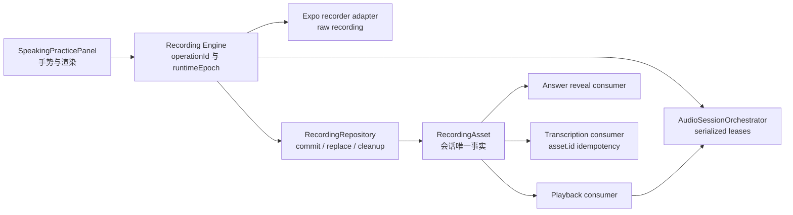
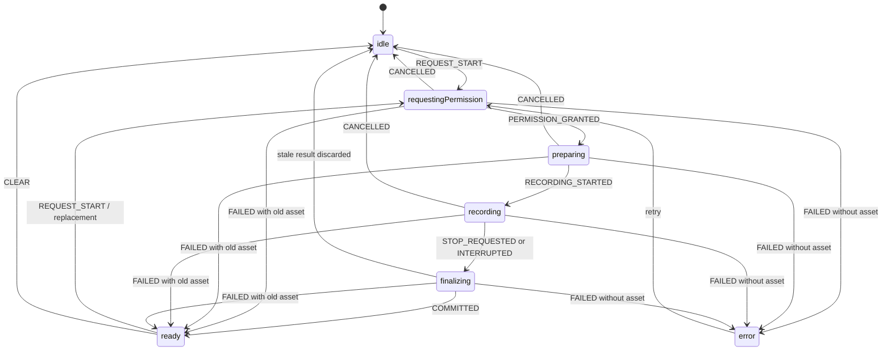

# 音频生命周期与变更规则

状态：长期强制规则

适用范围：随身听、题卡音频、录音、录音回放、麦克风权限、录音文件、转写触发、Expo Audio 或 Track Player 变更。

## 1. 不变量

1. 全局音频 session 只有 `AudioSessionOrchestrator` 一个协调者，只有它能调用 `setAudioModeAsync`。
2. 录音生命周期只有 `RecordingEngine` 一个 owner；`useSpeakingRecordingController` 只是 React 连接层，UI 不持有原生 recorder，也不删除文件。
3. `RecordingRepository` 是提交后录音文件的唯一仓库和删除 owner；原生 adapter 只产出 raw 文件。
4. `RecordingAsset` 在 `recording/types.ts` 只有一个定义，asset ID 是转写幂等键。
5. 录音提交成功即写入学习会话、展开答案、切到“我的回答”；回放和转写是互不回滚的消费者。
6. 回放失败、转写失败、重渲染和播放器卸载不得删除或撤销已提交资产。
7. 重录必须先提交新资产，再替换会话状态，最后删除旧资产；新录音失败时旧资产原样保留。
8. 录音结束后进入明确 idle profile，不自动恢复随身听或题卡音频。
9. 诊断事件不得包含录音内容、转写内容、URI、访问令牌或用户身份信息。

`pnpm check:audio` 和 ESLint 同时执行这些边界；不要以关闭规则、复制类型或创建兼容 coordinator 的方式绕过。

## 2. 所有权与依赖方向

| 能力 | 唯一 owner | 允许依赖 | 禁止事项 |
| --- | --- | --- | --- |
| 全局 session/profile | `src/platform/audio/audio-session-orchestrator.ts` | Expo Audio mode API、诊断 | UI/Provider 直接改 mode；第二 owner registry |
| 随身听引擎 | `RadioPlayerProvider` + Track Player | orchestrator lease、共享题库/资源 resolver | 私有题库或私有音频 session |
| 题卡音频 | `StudyAudioPlayer` | orchestrator lease、平台稳定 player | 录音中抢占播放；自行恢复随身听 |
| 录音生命周期 | `RecordingEngine` | recorder adapter、repository、orchestrator | UI/Hook 再建状态机、依赖回放状态判成功 |
| 原生录音 | `expo-recorder-adapter.ts` | Expo recorder/权限/preset；仅 E2E raw WAV 写入 | 提交资产、删除已提交资产、业务发布 |
| 录音资产 | `RecordingRepository` | Expo FileSystem | 组件直接删除；URI 充当身份 |
| 录音回放 | `useRecordingPlayback` | stable player、repository existence、orchestrator | 加载失败清 asset；initial source 与 replace 双驱动 |
| 转写 | `StudyWorkbench` / AI client | 用户点击“转写”后，上传已提交录音资产的 URI | 以 URI/时长做幂等键；失败回滚录音 |

合法依赖方向：

消费者之间不得互相调用。特别是 playback 不能决定 Answer/ASR 是否成立。

## 3. session 协调规则

- owner 固定为 `radio | study | recording | recordingPlayback`。新增 owner 必须先修改本指南、测试和结构检查。
- `acquire`、旧 owner `deactivate`、profile 切换和 `release` 全部在同一串行队列。
- 旧 owner 暂停或 mode 切换最多等待 2 秒；失败返回类型化错误，不发布新 lease。
- `recording` 是独占 owner；录音持有 lease 时，其它播放请求返回 `recording_exclusive`。
- lease token 递增；旧 lease 的 release 是无副作用操作，不能释放新 owner。
- owner 的 `deactivate` 必须等实际 pause 完成。它不能在 orchestrator 的 acquire 队列内反向调用 release，否则会死锁。
- release 只恢复 idle，不保存“上一个 owner”，也没有自动 resume 回调。

### Web 题卡参考音频

- iOS/Android 题卡继续由无平台后缀的 `StudyAudioPlayer.tsx` 和 Expo Audio stable player 管理。
- Expo Web 如果把 `loadeddata/isLoaded` 当成播放按钮前置条件，会与移动 Safari 的用户手势媒体策略形成死锁；Web 题卡因此由 `StudyAudioPlayer.web.tsx` 隔离管理一个持久 `HTMLAudioElement`。
- Web 元素仍属于既有 `study` owner。点击播放必须在用户操作同步栈内调用原生 `play()`，同时异步获取 orchestrator lease；lease 失败、录音抢占、后台、暂停、切题和卸载都必须暂停元素并释放已有 lease。
- URI 就绪即可点击，不等待 `loadeddata`；只有用户点击或已解锁后的尽力自动播放开始后，才允许启动首帧超时。
- Web 下一题预热不拥有 session 或播放状态，只能在当前题产生首帧后使用至多一个独立浏览器 `Audio` 元素做尽力预热。
- Web Production 构建从当前不可变内容 release 校验并物化 `question-bank-assets`，播放器只读取同源 `/question-bank-assets/*`。资源 manifest、checksum 和原 Vercel 分片仍是唯一发布事实；同域构建产物只是经过校验的交付镜像，不得成为第二套音频映射或内容来源。iOS/Android 继续使用原生 resolver，不读取该 Web 镜像。

### 随身听原生间隔轨道

- 播放间隔由既有 `RadioPlayerProvider` + Track Player playback service 共同持有，不新增 session owner、player、timer service 或第二队列状态机。
- 0 秒不得插入占位轨道；1–30 秒使用 `assets/audio/radio-interval-silence-30s.wav`，该文件必须保持可由 `ffprobe` 验证的 30 秒本地静音资源。
- playback service 识别 `radioTrackKind: interval` 后固定 1× 并 seek 到 `30 - intervalSeconds`；内容轨道恢复用户倍速。
- 静音轨道必须复制当前内容的锁屏标题、artist 和 album，等待结束前 Provider 不得推进逻辑题目或写入下一题快照。
- 等待期间 radio lease 保持不变；暂停/继续只控制同一原生轨道。手动切题跳过等待，静音轨道异常跳到已准备内容，内容错误仍进入原有重试态。
- UI、迷你播放器和持久化只能订阅 Provider 暴露的 `intervalSeconds`、`intervalRemaining` 与 `waitingForNext`，不得从 JS 时间差推导第二份倒计时事实。

## 4. 录音状态机

- stop 必须幂等；同一次操作的重复松手共享同一个 Promise。
- 每次 start 创建新的 operation ID。权限、prepare、stop、commit 的异步结果只有 operation 与 runtime epoch 仍匹配时才能发布。
- iOS 生产录音默认直接使用 Expo SDK 55 `RecordingPresets.HIGH_QUALITY`，不得在生命周期修复中同时覆写采样率、声道、码率或编码器。若要更换 preset，必须作为独立变更取得同一候选的真机证据。
- Native `prepareToRecordAsync()` 成功就是录音器准备合同，不再用一次 `canRecord` 快照二次否决；`record()` 后必须等待公开的 `recorder.isRecording` 底层事实，不能用 Expo 包装层 `getStatus().isRecording` 单独确认。
- Native prepare 拒绝只保留 `audio-session-configuration | native-recorder-prepare | unknown-native-prepare` 三类脱敏原因，不记录原生错误原文、URI 或录音内容。
- Native 的 Recorder 时长只读取 stop 前后的 `RecorderState.durationMillis`；Engine 用单调时钟独立记录操作时长，Repository 用容器和平台解码器取得媒体时长。三者只能交叉检查，不能互相覆盖；不得使用 `AudioRecorder.currentTime` 推导毫秒。
- 后台、卸载、被其它 owner 取代会使 operation 失效并清理 raw/新提交的过期资产。
- 原生录音器意外结束会发 `INTERRUPTED` 并进入 finalizing；如果停止结果无效，进入显式失败态。
- Native Promise 超时后 runtime 标记为 tainted，旧 Promise 只负责迟到清理；只有其 settle 并完成清理后才能增加 runtime epoch、重建 recorder。

### Web 浏览器录音边界

- Web 首次录音必须先用一次普通点击完成麦克风授权；授权成功后关闭临时音轨，等待用户再次按住录音。权限弹窗不得与按住/松开手势共用同一次操作；取消后重试时，旧权限请求的迟到结果不得清除新请求的等待计时或解锁录音按钮。
- `MediaRecorder.isTypeSupported()` 只能用于缩小候选范围，不能作为唯一能力判定。现有 WebM/Opus、WebM、MP4 的 128 kbps 成功路径保持优先；显式构造失败后才尝试无固定码率和浏览器默认格式。
- `dataavailable`、`error`、`stop` 和音轨 `ended` 必须在 start 前监听。主动停止、浏览器意外停止和重复 stop 共用一个幂等终结器；adapter 必须通过运行事件通知 Engine，不能依赖时长变化观察中断。
- `requestData()` 只是尽力 flush；它失败时仍必须调用 `stop()`。停止等待最终数据最多 5 秒，超时、意外停止或页面失活都要释放轨道和 lease，并且不得替换旧资产。
- Web adapter 可以把原始 `Blob` 交给既有 repository 校验并转移 Blob URL 所有权；Blob 的 MIME 标签规范为 `audio/webm`、`audio/ogg` 或 `audio/mp4`，避免 codecs 参数破坏既有 Vercel data URL 协议，编码字节不得重写。UI 仍不得持有 Blob、撤销 URL 或决定提交成功。

## 5. 文件提交、替换与清理

`commitRaw` 的固定顺序：

1. 检查单调时钟记录的操作时长至少 400 ms；不得把它写回媒体时长。
2. 等待文件写入稳定；Native M4A 检查 `ftyp`、`moov`、非空 `mdat`、`soun` 音轨及 `mdhd` 时长，WAV 从格式头计算时长，不得按码率或 bytes/ms 猜有效性。
3. 使用独立、只加载不播放的媒体探针确认目标平台解码器能读取文件；媒体时长与操作时长差异不得超过 `max(500 ms, 20%)`。Web 探针借用 Repository 创建的唯一 Blob URL。
4. 复制到 `Paths.cache/icao-recordings/<sessionId>/<assetId>.<format>.pending`。
5. 校验 pending 大小与 raw 一致。
6. 同目录 pending move 为正式文件，再校验目标；这是事务式提交，不宣称跨平台原子 rename。
7. 只有目标有效后删除 raw 并返回 `RecordingAsset`；其 `durationMillis` 使用解码器读取的媒体时长。

任何步骤失败都清理 raw/pending/不完整目标，但不得碰旧 `RecordingAsset`。学习会话 finish/unmount 时清目录；App 启动时清理超过 24 小时的孤儿 session。录音保持学习会话级，不承诺跨重启恢复。

## 6. 回放与转写隔离

- iOS/Android 录音回放使用 `useAudioPlayer(null)` 创建稳定实例，每次只通过 `replace(uri)` 装载；Web 录音回放使用平台文件中的单个持久 `HTMLAudioElement`，但仍属于既有 `recordingPlayback` owner。
- `useAudioPlayer` 自己拥有 native shared object 的释放；组件仍挂载时不得调用 `player.remove()`。无资产时只暂停并等待，后续资产仍由同一个实例 `replace(uri)`。
- Native 的 4 秒加载超时或 native error 只设置 `playback_load_failed`；确认文件被系统清理时设置 `asset_missing`。
- Web 不得在用户点击前因 metadata 延迟而判定 Blob 失效；点击栈内同步 `play()` 后，播放 Promise 与 lease 获取共同受 4 秒启动上限约束，超时只显示可重试引导且不得删除录音。
- `asset_missing` 也只禁用回放，已经展开的答案和已有转写仍保留。
- 每次播放前获取 `recordingPlayback` lease；完成、暂停、后台、错误或卸载后释放。
- 转写只能由用户点击“转写”发起；同一时刻只允许该资产的一次在途请求。失败后由用户再次点击“转写”重试，重录成功后使用新资产 ID。
- 首次使用 AI 或同意政策版本变化时，必须在上传录音或发送回答文本前显示本次数据去向、用途和保留期限；只有用户明确选择“同意并继续”才能发起请求，拒绝或关闭弹窗不得上传。
- 本地 AI 同意只用于界面提示，不能作为当前账号已经完成服务端登记的证据；每次 AI 操作前都要幂等同步账号级服务端同意，避免换号、撤回或恢复本地存储后产生假阳性。
- API 暂存录音前必须把 `audio/x-wav`、`audio/wave`、`audio/vnd.wave`、`audio/x-pn-wav` 规范为 `audio/wav`，把 `audio/x-m4a` 规范为 `audio/mp4`；content type 与扩展名必须同步规范化。
- 新资产有新 ID，因此重录成功只对新 ID 触发；重录失败仍保留旧 ID 和旧结果。

## 7. 错误码与排障顺序

| 范围 | 主要错误码 | 首先检查 |
| --- | --- | --- |
| session | `owner_pause_timeout`, `owner_pause_failed`, `mode_switch_failed`, `recording_exclusive` | 当前 owner、deactivate 是否 await、原生 mode 调用 |
| recorder | `microphone_permission_denied`, `microphone_device_missing`, `microphone_device_unavailable`, `recording_browser_unsupported`, `record_prepare_failed`, `record_start_failed`, `record_stop_failed`, `recording_interrupted`, `recording_finalization_timeout` | 权限、Web 能力、设备占用、TestFlight build、AppState、operation/runtime epoch |
| repository | `recording_too_short`, `recording_file_incomplete`, `recording_container_invalid`, `recording_media_unreadable`, `recording_media_duration_mismatch`, `recording_commit_failed`, `recording_asset_missing` | 操作/Recorder/媒体时长、容器音轨、平台解码、pending/目标大小、cache 清理 |
| playback | `playback_load_failed`, `playback_start_failed`, `asset_missing` | asset 是否存在、replace 是否唯一、lease 获取 |
| transcription | `transcription_completed`, `transcription_failed`, `transcription_cancelled` | asset ID、multipart MIME 及规范化、账号级 AI 同意、登录状态、网络/AI API |

排障必须按以下顺序，避免继续打补丁：

1. 从内存环形诊断读取 owner 切换和 recording phase，不读取或打印录音内容/URI。
2. 确认 `RecordingAsset` 是否已经 commit；若已 commit，禁止从 playback/ASR 错误回滚。
3. 确认当前 owner/lease token 和旧 owner 的实际 pause 结果。
4. 确认 operation/runtime epoch 是否过期、stop 是否被合并、AppState 是否触发取消。
5. 最后再检查 player load 或服务端 ASR；不能先改 UI 状态掩盖生命周期错误。

### Web 有声播放的用户手势边界

- iOS 浏览器首次有声播放必须在用户点击处理函数的同步调用栈内发出，不能在 `await` 音频 lease、模式切换或其他 Promise 之后再调用 `play()`。
- `StudyAudioPlayer.web.tsx` 必须复用其既有持久 `HTMLAudioElement`。首次手动播放仍先发起既有 `study` lease 申请，但要在同一次点击回调内同步调用该元素的 `play()`；不得再新增第二 player 或第二 session owner。
- `use-recording-playback.web.ts` 对用户录音遵守同一规则：复用一个持久 `HTMLAudioElement`，在同一次点击回调内同步调用 `play()`，并行获取既有 `recordingPlayback` lease；回放失败不得删除或回滚已提交录音。
- lease 获取失败、页面失活、题卡切换或 generation 过期时，必须暂停该次播放并释放迟到的 lease。Native 和后续已解锁的切题自动播放继续遵守“lease 获取完成后播放”的原有顺序。
- 回归测试必须让 Web mode 切换 Promise 保持 pending，并断言 `play()` 已在 Promise 完成前调用；只验证最终播放状态不足以覆盖浏览器用户手势约束。

## 8. 风险分级验收矩阵

| 变更 | Jest / 静态 | iOS | Android | 发布证据 |
| --- | --- | --- | --- | --- |
| UI 文案/样式且不碰音频行为或敏感文件 | 通用验证矩阵 + 渲染对比 | 只检查受影响目标端 | 只检查受影响目标端 | 无新增音频证据 |
| Web 题卡播放、手势或资源解析 | `pnpm check:audio` + 相关测试 + `pnpm check:web` | 移动 Safari 目标路径 | 按受影响浏览器检查 | 发布前保留 Web 代表性证据 |
| Engine/repository/playback/session | `pnpm check:audio` + 聚焦竞态测试 + typecheck | iOS 用户可见变更直接进入同一 commit 的 TestFlight 真机验收 | 合同测试；发布任务再做目标端真机 | 保存候选 commit、build、archive/IPA checksum |
| Expo Audio/权限/preset/native config | 上述全部 + SDK 55 API 核对 | Release archive + TestFlight 真机 | 发布任务做 Release/真机 | 受影响平台候选证据必须刷新 |
| Track Player/后台/锁屏 | queue/session 测试 | 真机锁屏/控制中心 | 媒体通知/后台 | 受影响平台指纹必须刷新 |

确定性 E2E：`pnpm audio:e2e:ios`、`pnpm audio:e2e:android`。它只在 `__DEV__` 且 `EXPO_PUBLIC_ICAO_AUDIO_E2E=1` 时生成静音 WAV 和固定转写；Release 构建脚本明确拒绝该标志。确定性 adapter 不替代真实麦克风冒烟。

发布脚本用 `tools/audio-sensitive-fingerprint.mjs verify <platform>` 检查 `.generated/audio-e2e/<platform>.json`。敏感文件变化后旧证据立即失效。

## 9. 修改前检查表

- [ ] 已读本指南和 Expo SDK 55 对应 Audio/FileSystem 文档。
- [ ] 已在 `docs/common-errors/audio-recording/README.md` 的单一历史台账中检索相同症状；不遍历旧 workstream 或已删除事故长文。
- [ ] 已确认没有可复用的 owner、repository、asset、player 或状态事件。
- [ ] 没有新增 `setAudioModeAsync`、recorder hook、权限或 preset 入口。
- [ ] 没有让 UI 直接 import Expo FileSystem 或删除录音。
- [ ] stable player 仍由 `useAudioPlayer` 释放，未在挂载期间调用 `player.remove()`。
- [ ] 新录音格式或 preset 的 MIME alias 已在 API 规范化，并有真实格式的 live verifier 证据。
- [ ] 成功判定包含 Repository 控制的非播放媒体探针，但不依赖业务回放、转写或组件渲染。
- [ ] 新异步步骤有 operation ID、runtime epoch、lease token 或明确幂等键。
- [ ] 错误不会删除旧资产，不会自动恢复旧音频。
- [ ] 诊断事件不含内容、URI、令牌或身份信息。
- [ ] 新的错误码、状态、owner 或文件阶段已更新测试和本指南。
- [ ] 已运行适用自动化；iOS 用户可见录音变更已由同一 commit 的 TestFlight 真机记录真实结果。

## 10. 故障知识维护

- `docs/common-errors/audio-recording/README.md` 是关闭问题的唯一历史台账；普通实现、重复验证和同类回归只更新现有条目，不创建长期事故长文。
- 复杂调查可以临时使用 `incident-template.md` 记录环境、复现、证据、根因和验证；问题关闭后必须把可复用结论合并进台账，并删除临时文档。
- 历史台账只保存症状、根因和防复发合同；本文继续保存唯一架构不变量。详细证据通过 Git 历史追溯，不复制第二套生命周期规范。
- 修复若没有恢复明确不变量，或没有增加可复现测试、静态门禁、类型化诊断、设备证据中的至少一项，默认不得标记为长期解决。
- 构建成功、模拟器成功、确定性 E2E 和历史请求成功不得代替当前版本的手机本体麦克风闭环。
