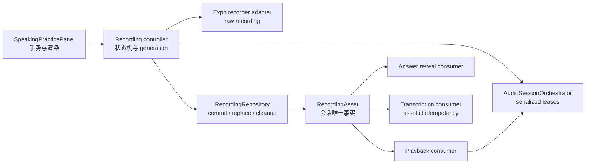
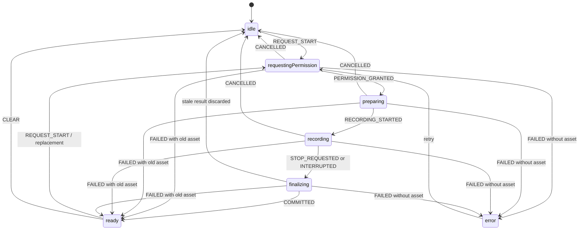

# 音频生命周期与变更规则

状态：长期强制规则

适用范围：随身听、题卡音频、录音、录音回放、麦克风权限、录音文件、转写触发、Expo Audio 或 Track Player 变更。

## 1. 不变量

1. 全局音频 session 只有 `AudioSessionOrchestrator` 一个协调者，只有它能调用 `setAudioModeAsync`。
2. 录音生命周期只有 `useSpeakingRecordingController` 一个控制器；UI 不持有原生 recorder，也不删除文件。
3. `RecordingRepository` 是提交后录音文件的唯一仓库和删除 owner；原生 adapter 只产出 raw 文件。
4. `RecordingAsset` 在 `recording/types.ts` 只有一个定义，asset ID 是转写幂等键。
5. 录音提交成功即写入学习会话、展开答案、切到“我的回答”；回放和转写是互不回滚的消费者。
6. 回放失败、转写失败、重渲染和播放器卸载不得删除或撤销已提交资产。
7. 重录必须先提交新资产，再替换会话状态，最后删除旧资产；新录音失败时旧资产原样保留。
8. 录音结束后进入明确 idle profile，不自动恢复随身听或题卡音频。
9. 诊断事件不得包含录音内容、转写内容、URI、访问令牌或用户身份信息。

`pnpm check:audio` 和 ESLint 同时执行这些边界；不要以关闭规则、复制类型或创建兼容 coordinator 的方式绕过。

## 2. 所有权与依赖方向

| 能力 | 唯一 owner | 允许依赖 | 禁止事项 |
| --- | --- | --- | --- |
| 全局 session/profile | `src/platform/audio/audio-session-orchestrator.ts` | Expo Audio mode API、诊断 | UI/Provider 直接改 mode；第二 owner registry |
| 随身听引擎 | `RadioPlayerProvider` + Track Player | orchestrator lease、共享题库/资源 resolver | 私有题库或私有音频 session |
| 题卡音频 | `StudyAudioPlayer` | orchestrator lease、稳定 Expo player | 录音中抢占播放；自行恢复随身听 |
| 录音生命周期 | `useSpeakingRecordingController` | recorder adapter、repository、orchestrator | UI 管 recorder、依赖回放状态判成功 |
| 原生录音 | `expo-recorder-adapter.ts` | Expo recorder/权限/preset；仅 E2E raw WAV 写入 | 提交资产、删除已提交资产、业务发布 |
| 录音资产 | `RecordingRepository` | Expo FileSystem | 组件直接删除；URI 充当身份 |
| 录音回放 | `useRecordingPlayback` | stable player、repository existence、orchestrator | 加载失败清 asset；initial source 与 replace 双驱动 |
| 转写 | `StudyWorkbench` / AI client | `RecordingAsset.id` 触发一次、asset URI 上传 | 以 URI/时长做幂等键；失败回滚录音 |

合法依赖方向：

消费者之间不得互相调用。特别是 playback 不能决定 Answer/ASR 是否成立。

## 3. session 协调规则

- owner 固定为 `radio | study | recording | recordingPlayback`。新增 owner 必须先修改本指南、测试和结构检查。
- `acquire`、旧 owner `deactivate`、profile 切换和 `release` 全部在同一串行队列。
- 旧 owner 暂停或 mode 切换最多等待 2 秒；失败返回类型化错误，不发布新 lease。
- `recording` 是独占 owner；录音持有 lease 时，其它播放请求返回 `recording_exclusive`。
- lease token 递增；旧 lease 的 release 是无副作用操作，不能释放新 owner。
- owner 的 `deactivate` 必须等实际 pause 完成。它不能在 orchestrator 的 acquire 队列内反向调用 release，否则会死锁。
- release 只恢复 idle，不保存“上一个 owner”，也没有自动 resume 回调。

### 随身听原生间隔轨道

- 播放间隔由既有 `RadioPlayerProvider` + Track Player playback service 共同持有，不新增 session owner、player、timer service 或第二队列状态机。
- 0 秒不得插入占位轨道；1–30 秒使用 `assets/audio/radio-interval-silence-30s.wav`，该文件必须保持可由 `ffprobe` 验证的 30 秒本地静音资源。
- playback service 识别 `radioTrackKind: interval` 后固定 1× 并 seek 到 `30 - intervalSeconds`；内容轨道恢复用户倍速。
- 静音轨道必须复制当前内容的锁屏标题、artist 和 album，等待结束前 Provider 不得推进逻辑题目或写入下一题快照。
- 等待期间 radio lease 保持不变；暂停/继续只控制同一原生轨道。手动切题跳过等待，静音轨道异常跳到已准备内容，内容错误仍进入原有重试态。
- UI、迷你播放器和持久化只能订阅 Provider 暴露的 `intervalSeconds`、`intervalRemaining` 与 `waitingForNext`，不得从 JS 时间差推导第二份倒计时事实。

## 4. 录音状态机

- stop 必须幂等；同一次操作的重复松手共享同一个 Promise。
- 每次 start 增加 generation。权限、prepare、stop、commit 的异步结果只有 generation 仍匹配时才能发布。
- 后台、卸载、被其它 owner 取代会使 generation 失效并清理 raw/新提交的过期资产。
- 原生录音器意外结束会发 `INTERRUPTED` 并进入 finalizing；如果停止结果无效，进入显式失败态。
- reducer 对非法转换返回原 state，不“猜测”调用者意图。

## 5. 文件提交、替换与清理

`commitRaw` 的固定顺序：

1. 检查停止时长至少 400 ms。
2. 等待文件大小稳定，检查文件存在、最低 10 KB 和格式对应的最低 bytes/ms。
3. 复制到 `Paths.cache/icao-recordings/<sessionId>/<assetId>.<format>.pending`。
4. 校验 pending 大小与 raw 一致。
5. 原子 move 为正式文件，再校验目标。
6. 只有目标有效后删除 raw 并返回 `RecordingAsset`。

任何步骤失败都清理 raw/pending/不完整目标，但不得碰旧 `RecordingAsset`。学习会话 finish/unmount 时清目录；App 启动时清理超过 24 小时的孤儿 session。录音保持学习会话级，不承诺跨重启恢复。

## 6. 回放与转写隔离

- 回放使用 `useAudioPlayer(null)` 创建稳定实例，每次只通过 `replace(uri)` 装载。
- 4 秒加载超时或 native error 只设置 `playback_load_failed`；确认文件被系统清理时设置 `asset_missing`。
- `asset_missing` 也只禁用回放，已经展开的答案和已有转写仍保留。
- 每次播放前获取 `recordingPlayback` lease；完成、暂停、后台、错误或卸载后释放。
- 自动转写用 `RecordingAsset.id` 记入 `attemptedTranscriptionKeys`，同一资产自动触发一次；重试是明确用户动作。
- 新资产有新 ID，因此重录成功只对新 ID 触发；重录失败仍保留旧 ID 和旧结果。

## 7. 错误码与排障顺序

| 范围 | 主要错误码 | 首先检查 |
| --- | --- | --- |
| session | `owner_pause_timeout`, `owner_pause_failed`, `mode_switch_failed`, `recording_exclusive` | 当前 owner、deactivate 是否 await、原生 mode 调用 |
| recorder | `microphone_permission_denied`, `record_prepare_failed`, `record_start_failed`, `record_stop_failed`, `recording_interrupted` | 权限、Development Build、AppState、generation |
| repository | `recording_too_short`, `recording_file_incomplete`, `recording_commit_failed`, `recording_asset_missing` | duration、稳定 size、pending/目标大小、cache 清理 |
| playback | `playback_load_failed`, `playback_start_failed`, `asset_missing` | asset 是否存在、replace 是否唯一、lease 获取 |
| transcription | `transcription_completed`, `transcription_failed`, `transcription_cancelled` | asset ID 是否变化、attempted key、网络/AI API |

排障必须按以下顺序，避免继续打补丁：

1. 从内存环形诊断读取 owner 切换和 recording phase，不读取或打印录音内容/URI。
2. 确认 `RecordingAsset` 是否已经 commit；若已 commit，禁止从 playback/ASR 错误回滚。
3. 确认当前 owner/lease token 和旧 owner 的实际 pause 结果。
4. 确认 generation 是否过期、stop 是否被合并、AppState 是否触发取消。
5. 最后再检查 player load 或服务端 ASR；不能先改 UI 状态掩盖生命周期错误。

## 8. 强制验收矩阵

| 变更 | Jest / 静态 | iOS | Android | 发布证据 |
| --- | --- | --- | --- | --- |
| UI 文案/样式且不碰敏感文件 | `pnpm check` + 渲染对比 | Simulator 渲染 | Emulator 渲染 | 无新增音频证据 |
| controller/repository/playback/session | `pnpm check` + 相关竞态测试 | Development Build + 真机录音冒烟 | Emulator Maestro + Development Build 录音冒烟 | 两平台指纹都需刷新 |
| Expo Audio/权限/preset/native config | 上述全部 + Expo Doctor | 重建 Development Build + 真机 | 重建 Development Build + 模拟器/真机 | 两平台指纹都需刷新 |
| Track Player/后台/锁屏 | queue/session 测试 | 真机锁屏/控制中心 | 媒体通知/后台 | 两平台指纹都需刷新 |

确定性 E2E：`pnpm audio:e2e:ios`、`pnpm audio:e2e:android`。它只在 `__DEV__` 且 `EXPO_PUBLIC_ICAO_AUDIO_E2E=1` 时生成静音 WAV 和固定转写；Release 构建脚本明确拒绝该标志。确定性 adapter 不替代真实麦克风冒烟。

发布脚本用 `tools/audio-sensitive-fingerprint.mjs verify <platform>` 检查 `.generated/audio-e2e/<platform>.json`。敏感文件变化后旧证据立即失效。

## 9. 修改前检查表

- [ ] 已读本指南和 Expo SDK 55 对应 Audio/FileSystem 文档。
- [ ] 已确认没有可复用的 owner、repository、asset、player 或状态事件。
- [ ] 没有新增 `setAudioModeAsync`、recorder hook、权限或 preset 入口。
- [ ] 没有让 UI 直接 import Expo FileSystem 或删除录音。
- [ ] 成功判定不依赖 player load、转写或组件渲染。
- [ ] 新异步步骤有 generation/lease token 或明确幂等键。
- [ ] 错误不会删除旧资产，不会自动恢复旧音频。
- [ ] 诊断事件不含内容、URI、令牌或身份信息。
- [ ] 新的错误码、状态、owner 或文件阶段已更新测试和本指南。
- [ ] 已运行适用的自动化、Development Build、真机矩阵并记录真实证据。
