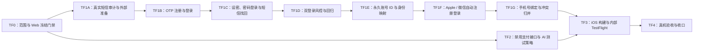
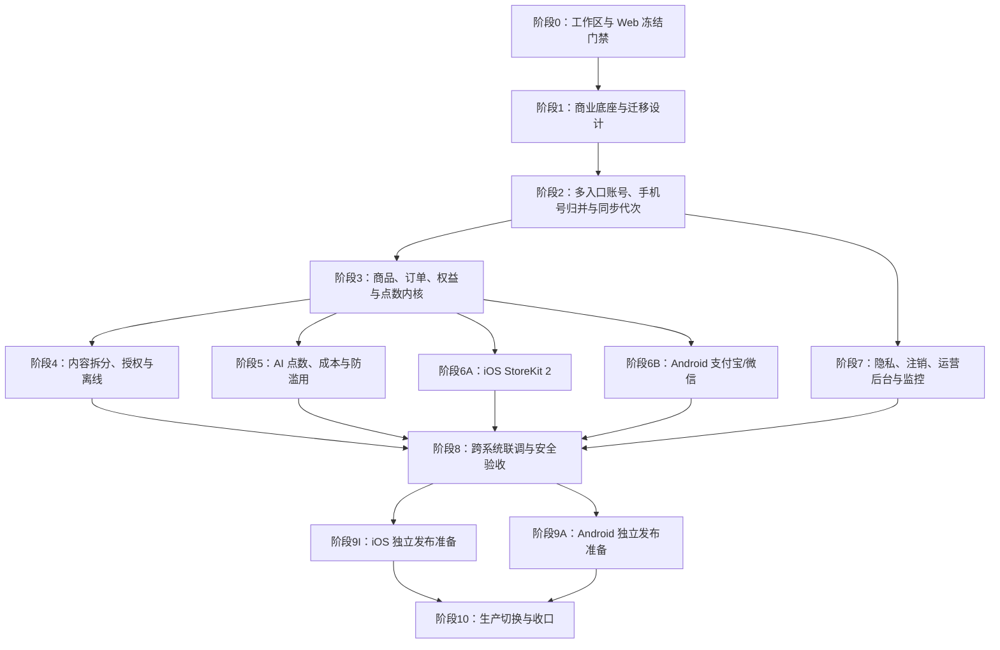

# Native App 正式商业上线执行路线图

状态：多入口账号与 Auth 网关为本地候选；生产 API/网关和内部 TestFlight 已授权但尚未更新/上传
制定日期：2026-08-12；状态更新：2026-08-13
需求：[requirements.md](requirements.md)
技术方案：[technical-plan.md](technical-plan.md)
技术盘点：[technical-audit.md](technical-audit.md)
人工事项：[manual-actions.md](manual-actions.md)

## 1. 执行原则

路线按技术依赖和风险排序，不按 D1—D9 的决策顺序开发。每个阶段都必须交付一个可独立验证、可
关闭或可继续的结果；阶段内按 `确认事实 → 最小闭环 → 实现 → 定向验证 → 审查 → 记录` 执行。

负责人已授权进入内部 TestFlight 实施。Codex 可以在当前 TF0—TF4 范围内连续完成代码、测试、本地
构建、生产 API/网关更新、内部 TestFlight 上传、真机验证、文档和收口，无需逐阶段等待。商业终局
阶段没有因本次授权自动启动。以下动作仍
必须停在人工门前：

- 新的产品范围/用户结果决策；
- 真实价格或 AI 点数表最终发布；
- 购买、签署协议、企业实名、短信核验和商店表单；
- Production 数据库迁移的备份/评审确认和临执行前明确确认；生产后台/法律页/APK 分发发布；
- 正式支付小额交易、退款和商店最终提交；
- 修改或部署冻结的用户 Web/Vercel。

任何阶段都不得运行 Vercel 部署。用户 Web 保持当前 production deployment，不是验收目标。

跨线程协调已确认共享热点稳定，依赖 `services/api/src/ai/*`、`services/api/src/app.module.ts`、
`services/api/src/config.ts` 与 `packages/contracts` 的最终 API/full checks 已按顺序重跑通过。此前针对
生产 API/网关和内部 TestFlight 上传的协调冻结已由用户后续连续执行授权覆盖；用户 Web/Vercel 仍
永久冻结。当前新增登录能力依然只在本地，检查通过不等于已经部署或已经上传。

## 2. 当前路线：内部 TestFlight 技术预览

| 阶段 | 交付 | 验证 | 当前人工闸门 |
| --- | --- | --- | --- |
| TF0 | 记录工作区所有权、Native/Web 边界和冻结门禁 | 冻结路径无新增差异；无 Web 构建或 Vercel 调用 | 无 |
| TF1A | 阿里云已锁定；“云启航科成都”签名/通用模板已审核并实发；Hook/adapter、预算与 Secret 边界 | 本地签名校验、发送映射、限额、配置失败关闭和代表号码收件 | 三网号码、公开放量前共享风控；后续充值/受保护凭证仅在触发时介入 |
| TF1B | Native 取消邀请码；自有 API 发起 `+86` OTP 自动注册/登录；公网 `/otp`、`/resend`、`/signup` 阻断 | 号码、OTP、会话、网关绕过、枚举防护和 Production 无测试码的本地测试 | 三网到达与部署后会话验收 |
| TF1C | 首次设密/修改、手机号密码登录、自有 API 找回发码；公网 user 修改阻断 | OTP/密码复用同一身份；未知/已知找回同形；受保护 API 改密 | 真实 Auth 配置与双端同一 `userId` 验收 |
| TF1D | 双入口 UI、密码规则、倒计时、基础号码/总量限流与本地回归 | 错误一致性、签名/重放防护、模拟器视觉验收 | 持久多实例预算、设备/IP 风控、真机与弱网回归 |
| TF1E | `accounts` / `account_identities`、Guard 解析永久 `accountId` | 旧手机号账号兼容、身份唯一性、迁移与回滚验证 | Production 迁移需评审、备份和单独批准 |
| TF1F | Apple 原生登录；微信 OpenSDK/code 交换、限流/去重、服务端会话桥接与10分钟单用途 grant | Apple OAuth AMR、微信重放/超限/grant 过期或重复消费、同一身份保持同一 `accountId` | Apple capability 已启用，待新描述文件和 Supabase；微信开放平台应用、AppID/Secret 与 Universal Link 尚未配置 |
| TF1G | 第三方稍后绑定手机号；未占用保留源 `accountId`，已占用才双凭证归并 | 两条事务直接返回 summary、并发/冲突/回滚测试 | 双端真机和代表性既有账号验收 |
| TF2 | 稳定支付合同、禁用提供方、支付开关关闭；可配置 AI 推荐测试策略 | 无支付 SDK/网络/订单/权益；测试点数可整体替换 | 无 |
| TF3 | iOS 自动检查、Release/Archive 与内部 TestFlight 候选 | 自动化、包检查、真机核心流程、Web 零变化 | Apple 登录或2FA提示时配合 |
| TF4 | 内部测试记录、问题修复、阶段日志与差距清单 | 邀请码不可登录；OTP/密码双登录通过；支付保持禁用 | 测试员接受邀请、安装和设备操作 |

### 当前执行快照（2026-08-13）

- **TF0 已完成**：建立 326 个受保护输入的 Web/Vercel 冻结基线，正常检查和伪造篡改自测均通过；
- **TF1A—TF1G 本地候选已完成**：Native 已提供微信、Apple、`+86` OTP/密码、自动注册、设密/找回、
  稍后绑定和冲突归并；普通/找回发码及密码更新已收口到自有 API，公网 Auth 写入口具备网关门禁；
  Apple OAuth AMR、微信单用途 grant/code 防重放、未占用手机号保持源 `accountId` 和事务 summary 已
  纳入本地实现。现有 TestFlight 已收到真实阿里云验证码；目标
  品牌签名“听你五个”因尚无注册商标且不满足当前平台来源要求而延期；三网、Apple 新描述文件与
  Supabase、微信开放平台配置、账号迁移/部署、持久多实例风控和双端真机同一 `accountId` 仍未完成；
- **TF2 本地占位已完成**：禁用支付提供方及可替换测试点数策略 2 个套件共 6 项通过；没有支付 SDK、
  商品、网络请求、订单或权益副作用；
- **TF3 未完成**：只完成本地 iOS 模拟器渲染和发布配置检查；生产 API/网关更新和内部 TestFlight
  上传虽已授权，但尚未执行；
- **TF4 未开始**：没有可安装的 TestFlight 构建，因此尚未触发测试员设备动作。
- **稳定态复验已完成**：contracts TypeScript 通过；API 类型/Lint/构建与12个 Vitest 文件/
  264项测试通过；App 发布配置、4个 Native 法律页、UI 验收、音频边界、类型/Lint 与82个
  Jest 套件/419项测试通过；仅有既有 React 19 overlapping `act()` 控制台警告，无失败。线上 Web
  未触碰；严格冻结门禁因8个共享输入差异保持失败，未擅自重设基线，且没有修改 AI/录音实现来消除失败。

详细证据和检查有效性边界见 [本地执行记录](evidence/local-execution-2026-08-12.md)。

### TF0：范围与冻结门禁

1. 记录开始时已有改动并区分本阶段文件，禁止覆盖无关用户工作；
2. 识别 Native、必要 App API、Web 专属文件和发布命令；
3. 建立/更新 Web 冻结检查，确保本阶段不修改、不构建、不预览、不部署 Expo Web/Vercel；
4. 所有实现按小流程留下真实测试证据，未运行项目明确说明原因。

若一项实现必须改变 Web/Vercel，立即停止该项，不以共享代码便利为理由绕过冻结边界。

### TF1A：真实短信供应商、签名模板与成本审计

1. 使用已锁定的阿里云国内短信，确认企业账号、ECS 出口区域、Send SMS Hook/适配器兼容性、API
   回执、可用性和支持边界；腾讯云不在首发范围；
2. 沿用已经审核的主体“云启航科（成都）科技有限公司”、签名“云启航科成都”和覆盖注册/登录/找回
   密码的通用身份验证码模板；“听你五个”在商标注册完成或具备平台认可材料前禁止不实提交；
3. 对比按量/套餐价格，设置月预算、余额/套餐告警、发送总闸和异常增长告警；
4. 供应商控制台限频与应用层号码/设备/IP/账号限流叠加，不依赖单一 IP 封禁；
5. 生产凭证只进入服务器 Secret，日志和聊天不得出现 Secret 或 OTP；
6. 用三网代表号码验证到达、延迟、失败回执和拦截，再锁定正式供应商。

TF1A 的真实发送前置闸门已由“云启航科成都”签名和通用模板完成；仓库侧 Hook、阿里云 adapter、
配置合同和基础预算也已完成。当前后续工作是三网、共享风控与端到端验收；不为品牌展示目的冒用
商标来源，也不把本地检查自动解释为已经完成生产部署。

### TF1B：OTP 注册与登录

1. Native 验证码登录只接受中国大陆手机号；删除邀请码输入、提示、可执行请求与导航入口；
2. 普通 OTP/自动注册统一调用自有 `POST /v1/auth/phone/otp/start`，由 API 内部发起 GoTrue OTP；公网
   网关阻断 `/auth/v1/otp`、`/auth/v1/resend`、`/auth/v1/signup`，客户端不能绕过统一风控；
3. API 的 Native 身份校验退出 `invite_accounts` 强依赖，以稳定 `accountId` 作为业务身份；
4. 接入 `SmsOtpProvider`/Supabase Send SMS Hook；开发期受控测试 OTP 继续三重失败关闭，Production
   必须完全移除固定测试码；
5. 覆盖规范化、发送倒计时、重复发送、验证码错误/过期/重复、会话恢复、退出、枚举防护和限流；
6. 不迁移旧邀请码账号或数据，不执行破坏性历史表删除。

### TF1C：首次设密、密码登录与短信找回

1. 用户首次通过 OTP 登录后，在当前 Supabase user 上设置密码，不再次注册；
2. 登录页提供清晰的“验证码登录 / 密码登录”切换，共用手机号输入和统一错误语义；
3. 密码登录使用 Supabase phone/password，服务端 Guard 只验证合法手机号身份与 token；
4. 忘记密码调用自有 `POST /v1/auth/phone/recovery/start`；服务端内部使用
   `shouldCreateUser=false`，未知/已知号码都返回同形结果和统一最短响应时间，未知号码不得新建账号；
5. 首次设密/修改/找回后的密码写入统一调用受保护 `POST /v1/account/password`；公网网关阻断
   `PUT/PATCH /auth/v1/user`，客户端不能绕过当前密码或近期 OTP；
6. 明示密码规则、输入可见性、提交状态和错误；修改密码需要近期认证或短信重认证；
7. 同一手机号在两种方式及双端登录后必须得到同一 `auth.users.id`。

### TF1D：风控、回归与真机验收

1. OTP 发送/校验和密码失败分别按号码、用户、设备与 IP 限流，使用中性错误避免账号枚举；
2. 覆盖弱网、并发、倒计时恢复、App 前后台、重装、切号、全设备退出和注销后同号新注册；
3. 验证 OTP 与密码交叉登录共享学习记录、会员、点数和同步状态；
4. iOS/Android 代表真机和国内三网手机号完成回归；
5. 不存在邮箱或邀请码登录；Apple/微信只在对应官方配置完整时可执行，缺失时失败关闭。

### TF1E：永久账号与多身份映射

1. 新增永久 `accounts` 与 `account_identities`，现有账号以原认证 ID 兼容回填；
2. API Guard 将 Supabase 认证身份解析为业务 `accountId`，普通业务 API 不再强制手机号；
3. 学习、会员、点数、订单和同步统一使用 `accountId`，认证 ID 只用于会话与安全审计；
4. 迁移先在空库和结构副本验证；Production 必须先评审、备份、执行和迁移后核验。

### TF1F：Apple、微信与自动注册

1. 手机号 OTP 改为验证成功后自动注册/登录，密码登录和找回仍不创建未知账号；
2. iOS 使用原生 Apple ID Token + nonce 登录 Supabase，首次成功自动创建账号并进入；
3. iOS/Android 使用微信 OpenSDK 获取一次性 code，服务端交换微信身份并桥接为 Supabase 会话；
4. 微信交换入口按来源限流，对 code 的密钥摘要做窗口去重；成功交换后为当前
   `authUserId + sessionId` 签发10分钟、手机号绑定专用且消费一次即失效的服务端 grant；
5. Apple 绑定近期认证只接受当前会话中 method-specific OAuth AMR，不接受更晚的 TOTP/其他 AMR；
6. 微信 AppSecret 和 access token 只在服务端，Apple/微信错误、取消、重放和配置缺失均失败关闭；
7. 同一提供方身份跨重装和跨设备必须解析到同一 `accountId`。

### TF1G：稍后绑定手机号与账号归并

1. 第三方用户可跳过手机号绑定继续普通学习，账号安全页显示未绑定提示；
2. 未占用手机号经 OTP 验证后关联当前源账号，源 `accountId` 保持不变，可随后设置密码；
3. 已占用手机号由服务端同时校验当前第三方会话和目标手机号 OTP，以原手机号账号为主事务归并；
   归并成功后才向 App 返回手机号主账号会话，失败时 App 保持当前第三方会话；
4. 未占用绑定和已占用归并都在同一事务内生成最终账号摘要，事务提交后不再调用可能把成功误报为
   失败的额外 summary 查询；
5. 归并学习、同步、会员、点数和订单归属，移动第三方身份、撤销源账号会话并审计；
6. 同一提供方不同身份、不可兼容订单/实名信息或并发变化失败关闭，不静默覆盖。

### TF2：商业接口占位与 AI 测试策略

1. 定义稳定 `CommerceProvider` 合同及 `DisabledCommerceProvider`；
2. 固定 `commerce=false`，隐藏购买入口或显示“当前测试版本未开放购买”；
3. 不安装 StoreKit、支付宝、微信依赖，不配置商品、渠道 AppID、通知或商户密钥；
4. 禁用提供方不得联网、创建订单或授予权益，并由自动测试证明失败关闭；
5. 将 AI 免费体验点数、能力扣点和安全阈值收敛到带策略 ID 的推荐测试配置；
6. 推荐值只服务内部验证，可整体替换，不写入正式价格或公开承诺。

### TF3：iOS 候选与内部 TestFlight

1. 运行与影响范围匹配的类型、单元、API 和 Native 检查；
2. 核对 TestFlight 配置不包含支付依赖、Production 测试 OTP 回退或 Web 发布行为；
3. 在可用 Apple Team 下生成 iOS Release/Archive，检查 Bundle ID、版本、签名、权限和运行时；
4. 生产 API/网关更新和内部 TestFlight 上传已经纳入当前授权；在自动检查、数据库迁移闸门和 Apple
   登录状态满足后连续执行，遇到登录、2FA 或账号验证码再请求负责人操作；
5. 不开启外部测试，不提交 App Store 审核，不操作付费协议、税务银行或内购商品。

### TF4：真机验收与收口

1. 测试员接受内部邀请并在设备安装；负责人只处理无法自动替代的邀请接受、信任或设备动作；
2. 验证启动、OTP/密码双登录、设密/找回、Apple/微信会话、手机号绑定/归并、会话恢复、核心学习、
   AI 测试点数提示和支付禁用状态；
3. 修复本里程碑缺陷并重复定向验证；
4. 更新阶段日志，列出商业终局仍待完成的支付、内容、运营、备份、法律与正式发布事项；
5. 证明现有 Web/Vercel 从开始到收口没有被修改或部署。

### 当前里程碑出口

- Native 正式交互中不存在邀请码/邮箱登录；iOS 提供微信、Apple、手机号 OTP/密码，Android 提供
  微信、手机号 OTP/密码，第三方首次登录可先进入后绑定；
- 测试 OTP 无法在 Production 配置启用；
- 普通/找回发码和密码更新只经自有 API；公网 Supabase 发码、注册和 user 修改路径被阻断；找回未知/
  已知号码同形；Apple OAuth AMR 与微信10分钟单用途 grant 的绑定闸门有效；
- 真实短信供应商、公司名签名/模板和三网证据可用；所有入口返回稳定 `accountId`，OTP 与密码一致，
  未占用手机号绑定保留源 `accountId`，冲突手机号安全归并到原手机号账号；
- 支付接口稳定但真实支付完全未接入，所有渠道和购买副作用保持关闭；
- AI 推荐测试策略可配置、可替换且未形成公开承诺；
- iOS 内部 TestFlight 候选通过自动验证和可用真机验收；
- Web/Vercel 零修改、零构建、零部署；
- 阿里云企业认证、现用签名/模板和真实发送已完成；Apple capability 已启用。余下 Supabase/描述文件、
  微信平台、必要验证码、三网与测试员设备动作均按人工事项清单在触发后完成；除此之外没有未记录的
  人工事项。“听你五个”品牌签名不是当前出口条件。

达到这些条件后停止在 TF4，不自动进入下面的商业终局路线。

## 3. 商业终局路线总览（本次不执行）

以下阶段继续承载 D1—D9 的正式商业上线要求，但均为延期范围，需负责人以后明确启动。

6A/6B 和 9I/9A 可在底座完成后独立推进；哪端先满足门槛，哪端先进入发布，不互相等待。

## 4. 商业终局阶段门槛表

| 阶段 | 主要输出 | 自动执行边界 | 人工闸门 |
| --- | --- | --- | --- |
| 0 | 干净基线、Web 冻结 manifest、禁止路径门禁 | 盘点、脚本、测试、文档 | Vercel 自动部署关闭证据；冲突工作区处理授权 |
| 1 | 商业合同、schema、迁移/回滚设计、feature flags | 代码和本地迁移测试 | 生产迁移不执行 |
| 2 | 微信/Apple/手机号多入口、永久账号、手机号归并、14+、同步代次 | Staging、双端 UI/测试 | 短信、Apple、微信平台配置；生产 Auth 与迁移 |
| 3 | 商品/订单/权益/点数内核 | 全部本地/集成测试 | 最终 AI 点数表、渠道商品 ID/价格审批 |
| 4 | 免费/会员发布物、授权下载、加密缓存、72小时离线 | 内容生成、API、Native、解包检查 | 无新增产品决策时可连续 |
| 5 | AI 操作状态机、点数/成本、防滥用/熔断 | 模拟成本和供应商、Staging | 真实成本审计和预算阈值最终确认 |
| 6A | StoreKit 2、Apple 验签/通知/恢复 | StoreKit 配置、Sandbox 适配 | 公司 Apple 账号、商品、密钥和 TestFlight 操作 |
| 6B | 支付宝/微信 SDK、验签/通知/对账 | 模拟回调、SDK 集成、沙盒 | 商户签约、应用审核、密钥和小额真金测试 |
| 7 | 注销/留存/导出、内部后台、监控/备份 | 代码、Staging、恢复演练 | 法律终审、独立托管/DNS/告警联系人 |
| 8 | 双端端到端、安全、负载和故障演练证据 | 自动化、模拟器、可用真机 | 人工最终体验与真实渠道场景 |
| 9I | iOS 可提交包与材料 | Archive、校验、截图草稿 | App Store Connect 填报、签署、最终提交 |
| 9A | Android 正式 APK 与分发包 | 构建、签名、摘要、材料 | Build Tools 许可、独立下载托管、最终发布 |
| 10 | 生产证据、运行手册、closeout | 获授权后的脚本化执行 | 迁移/部署/真实价格/对外发布逐项授权 |

## 5. 商业阶段0：工作区基线与 Web/Vercel 冻结

### 输入

- 已确认的总需求、D1—D9、技术盘点和技术方案；
- 当前包含用户其他改动的工作树；
- 当前 Vercel production deployment 状态。

### 工作

1. 记录商业化实施的目标分支/提交和全部已有改动，不覆盖无关用户工作；
2. 识别 Web 拥有文件、Web 专属模块、Vercel 配置和发布脚本；
3. 生成 checksum manifest 和 `check:web-freeze` 门禁；
4. 将 Native 商业化模块与冻结 `.web` 实现隔离；
5. 验证 release 脚本不会调用 Vercel、Web export 或 retired download flow；
6. 建立 phase log 和证据目录，只记录真实执行结果。

### 输出与验证

- Web 冻结 manifest、禁止路径清单和自动检查；
- 工作区冲突/所有权报告；
- `git diff --check`、链接检查和门禁自测通过。

### 停止条件

- 无法判断某个现有用户改动是否可安全保留；
- Vercel Git 自动部署仍开启且一次 push 可能改变生产网页；
- 实现必须修改冻结 Web 才能继续。

## 6. 商业阶段1：商业底座与迁移设计

### 工作

1. 在 contracts 建立账号、商品、订单、交易、权益、点数、内容凭证、AI 操作和后台合同；
2. 新增 Drizzle schema 和 migration，采用 expand/backfill/switch/contract；
3. 建立 feature flags、价格/点数/模型/成本策略版本；
4. 建立订单事件、权益事件、点数流水和投影重建器；
5. 建立后台任务 runner、幂等锁和模拟渠道适配器；
6. 制作生产迁移清单、备份要求、向前修复方案和数据不变量检查。

### 验证

- migration 在空库和生产结构快照副本上前向执行成功；
- 所有投影从事件重建后结果一致；
- 重放相同事件不会重复增益；
- 新表未启用时现有 App/API 行为保持可回滚。

### 阶段出口

数据库和合同可承载后续功能，但 Production 仍未迁移、所有商业开关仍关闭。

## 7. 商业阶段2：多入口正式账号与同步代次

### 工作

1. 完成已锁定阿里云的成本、资质、签名模板、限频和三网到达审计；
2. 配置/验证自托管 Supabase Phone OTP、Phone Password 与 Send SMS Hook；普通/找回发码统一由自有
   API 发起，公网 `/otp`、`/resend`、`/signup` 和 `PUT/PATCH /user` 由网关阻断；
3. 实现短信适配、找回未知/已知号码同形响应、统一错误、多维限流、冷却、每日预算和不含 OTP 的
   安全日志；
4. Native 登录实现微信、Apple（iOS）、验证码/密码入口、自动注册、倒计时、错误和14+协议；
5. 建立永久 `accountId` 和多身份映射；手机号是归并锚点，业务权益不直接绑定认证 ID；
6. 在已绑定手机号身份上设密/修改；密码登录和短信找回复用同一手机号身份；
7. 实现第三方稍后绑定；未占用号码关联并保留源 `accountId`，已占用号码双凭证归并；Apple 使用
   method-specific OAuth AMR，微信使用限流/去重 code 交换和10分钟单用途 grant；
8. 拆除 API Guard 的邀请码和手机号硬依赖，只接受可解析到活跃 `accountId` 的合法 token；
9. 实现手机号换绑、身份解绑、敏感操作重认证、设备管理和全设备退出；
10. 为同步增加 `dataGeneration`、清除学习数据 API 和旧代次拒绝；
11. 注销要求任一近期高可信认证，并解除全部身份映射；
12. 修订账号相关测试、法律文案草稿和商店审核登录说明。

### 验证

- 中国大陆号码格式、验证码过期/重复/弱网、密码错误/找回、号码枚举、防刷和共享网络误伤；
- 同一手机号通过 OTP 与密码得到同一 `accountId`；同一微信/Apple 身份重复登录一致；注销后同身份
  得到新 `accountId`；
- 双设备并发、离线恢复、换机、重装、切号、清除数据及旧设备回灌；
- 正式 Native 包没有邀请码或邮箱入口；Apple 只在 iOS 显示，微信只在官方配置完整时启用；
- 冻结 Web 仍保持原邀请码实现且没有生产部署。

### 可并行的人工工作

沿用阿里云已经审核的“云启航科（成都）科技有限公司”主体、“云启航科成都”签名和通用身份验证码
模板；该链路已有真实收件证据。继续完成三网、共享风控和正式环境验收。“听你五个”在商标注册完成
或具备平台认可材料前不提交；阿里云长期不可用时再另立供应商变更决策。

## 8. 商业阶段3：商品、订单、权益与 AI 点数内核

### 工作

1. 配置五档商品：7/15/31/62/93天，所有商品可重复购买且不自动续期；
2. 实现订单创建、超时、取消、支付事件接收、渠道查询和对账状态机；
3. 实现权益追加、跨端读取、重复购买和事件重建；
4. 实现退款/撤销的订单级重算，不误伤其他有效订单；
5. 实现点数计划批次、31天释放、累计、最终到期失效和免费体验点数；
6. 实现商品页、订单页、会员状态、点数余额/明细和服务端时间显示；
7. 提供模拟 Apple/支付宝/微信渠道完成端到端验证。

### 验证矩阵

- 五档商品单买、乱序多买、同一时刻重复通知、客户端重试；
- iOS 模拟购买后 Android 恢复，反向同理；
- 7/15一次性点数、31/62/93分批、跨月累计、重复购买延期；
- 到期清零后再购买不复活旧点数；
- 退款一笔、退款中间订单、重复退款和渠道延迟通知；
- 服务端与客户端时间偏差、并发购买和投影重建。

### 人工参数闸门

正式商品和用户文案启用前，负责人必须确认最终 AI 点数发放/扣点表。未确认时系统使用测试策略 ID，
但不会把临时数值写进正式材料或生产商品。

## 9. 商业阶段4：内容拆分、服务端授权与离线

### 工作

1. 将 D6 稳定 ID 变成版本化访问 policy；
2. 从唯一题库来源生成目录、免费正文、会员单元和资源映射；
3. 修改 Native repository，移除完整题库静态导入和整库 fallback；
4. API 按账号权益、内容范围和资源上下文授权；
5. 建立下载清单、进度、取消、重试、删除和本机空间检查；
6. 使用 AES-GCM 加密会员缓存，SecureStore 保存小型密钥；
7. 签发并校验账号/设备绑定、最长72小时且不越过会员到期的离线凭证；
8. 统一搜索、模考、随身听、深链接、答案和媒体访问策略。

### 验证

- 解包 iOS/Android Release 不能获得完整会员题库或音频；
- 免费账号直接调用会员正文、答案和资源接口全部被拒绝；
- D6 免费 ID 数量和内容精确匹配；题目重排不改变免费范围；
- 首次在线下载、72小时内离线、凭证过期、自然到期、退款、重购、切号和注销；
- 断点续传、损坏 checksum、内容版本更新、缓存密钥丢失和磁盘不足；
- Web 冻结 manifest 不变。

### 阶段出口

新 App 不再依赖内置整库；内容服务可以在商业开关关闭时只提供免费范围，不需要回退到不安全整库。

## 10. 商业阶段5：AI 点数、成本与防滥用

### 工作

1. 将 AI controller 全部接入统一 `operationId` 状态机；
2. 建立点数预占/结算/释放和内部成本预占/结算/释放；
3. 按实际音频秒数、Token、模型和价格版本记成本；
4. 实现单用户串行、10秒/1分钟高频窗口、设备/IP辅助风险和暂停恢复；
5. 实现日/权益段成本预警/停止、全局预算、供应商熔断和能力开关；
6. 返回预计扣点、实际扣点、余额、下一批时间和可理解错误；
7. 增加 AI 标识、模型/备案信息配置、投诉入口和输出安全事件；
8. 清理旧 `aiQuotaBuckets` 的业务引用，迁移历史日志但不伪造用户点数。

### 验证

- 相同 operation 并发/重试只调用供应商和扣点一次；
- 成功、供应商失败、超时、取消、进程重启和过期任务回收；
- 点数不足、点数充足但内部安全暂停、全局熔断三种提示严格区分；
- 正常连续学习不误触，高频机器人请求不能造成无限成本；
- 录音/回答正文不进入成本日志，注销和保留期处理符合 D7。

### 人工参数闸门

负责人确认供应商真实合同/账单、最终点数表和安全预算。阈值以后可在后台版本化调整，不需要重新
发布 App，但不能追溯减少已发放点数。

## 11. 商业阶段6A：iOS StoreKit 2

### 工作

1. 创建本地 Expo payment module 的 StoreKit 2 实现；
2. 建立五个 non-renewing subscription 商品映射；
3. 支持商品加载、购买、pending/cancelled/success、未完成交易监听和 restore；
4. 将签名交易发给 API，服务端验证 JWS并调用 App Store Server API 复核；
5. 接入 App Store Server Notifications V2、历史查询和退款/撤销；
6. 绑定 `appAccountToken` 或等效稳定账号关联，防止跨账号误领；
7. 用 StoreKit Configuration、Sandbox 和 TestFlight 逐级验证。

### 验证

- 重复购买五档、掉线恢复、换机、重装、跨 Android 读取；
- 客户端伪造、JWS错误、bundle/product/environment 不匹配；
- 通知先于客户端、客户端先于通知、重复和乱序；
- 退款后在线即时重算与离线72小时边界；
- iOS 不显示支付宝、微信或外部购买引导。

### 人工闸门

需要公司 Apple Team、付费协议/税务银行信息、商品创建、Server API/通知密钥配置、TestFlight 账号
和最终 App Store Connect 操作。

## 12. 商业阶段6B：Android 支付宝与微信支付

### 工作

1. 创建本地 Expo payment module 的 Android Kotlin 实现；
2. 接入支付宝与微信官方 App SDK，只接收服务端生成的调起参数；
3. 服务端实现下单、签名、异步通知验签、主动查询、关闭订单和退款查询；
4. App 处理未安装支付应用、取消、回到前台、网络中断和结果不确定状态；
5. 结果不确定时轮询服务端订单，绝不凭客户端字符串发权益；
6. 建立每日自动对账和差异告警；
7. 支付 SDK 权限、数据处理和第三方清单进入正式披露。

### 验证

- 两渠道五档商品、重复购买、重复/伪造/乱序通知和主动查询；
- App 被杀、返回参数丢失、渠道已扣款但通知延迟；
- 退款、部分渠道异常、跨 iOS 读取和同账号多设备；
- Release APK 签名、包名/AppID 绑定、权限和 SDK 清单。

### 人工闸门

需要支付宝 App 支付签约、微信移动应用/APP支付权限与商户号绑定、密钥证书配置和负责人执行小额
真实支付/退款。密钥不得通过聊天传递。

## 13. 商业阶段7：隐私、注销、后台、监控与容灾

### 工作

1. 完成账号资料、AI 结果、学习数据、订单和点数的自助查看/清除/导出；
2. 实现注销编排、法定记录隔离、失败重试和备份恢复后的注销重放；
3. 实现 D7 各保留期清理任务及执行证据；
4. 建设独立内部运营后台和 `/v1/admin/*`：管理员、客服、脱敏、MFA、最小权限和审计；
5. 建立第一方最小事件、结构化日志、业务指标、告警和运行手册；
6. 恢复独立故障域的数据库/Storage 加密备份，并进行隔离恢复；
7. 更新 App 内协议、第三方清单、备案/商店材料；准备法律页源码但不发布到冻结 Vercel。

### 验证

- 注销立即撤会话/权益/点数，24小时内完成活跃数据清除；同号新账号不恢复旧数据；
- 法定交易/安全记录隔离、客服不可恢复旧账号；
- 保留期任务幂等，备份恢复不复活注销账号；
- 客服无法访问管理员功能或无关敏感正文；所有高风险操作可追溯；
- 告警演练覆盖 API、支付通知、权益差异、AI预算、备份与清理失败；
- 内部后台 URL 和部署与 Vercel 完全隔离。

### 人工闸门

公司负责人/法律顾问终审政策协议；购买或确认备份/监控资源；提供内部域名、工作人员和告警联系人；
对法律页、后台和生产基础设施发布分别授权。

## 14. 商业阶段8：跨系统联调、安全与上线验收

### 自动验证

- `pnpm check` 及新增商业化检查；
- API/contracts 单元与端到端；数据库 migration 和投影重建；
- iOS/Android Development Build 和 Release 构建；
- 正式包解包、secret/旧域名/会员内容/开发入口扫描；
- 双设备、多账号、跨平台、弱网、离线、重装、升级、后台恢复；
- 支付、AI、内容、同步、注销的并发、重试和故障注入；
- 代表性负载、限流、备份恢复和回滚演练；
- Web freeze 检查和 Vercel 零部署证据。

### 人工验收

- 负责人使用正式外观的 iPhone 和 Android 设备走完新用户→购买→学习→AI→跨端→退款/重购→
  注销核心旅程；
- 核对所有价格、点数、年龄、协议、退款提示、AI 标识和客服文案；
- 使用真实渠道小额交易和退款验证账单/商户后台/服务端订单三方一致；
- 确认商店截图不含开发入口、测试数据或真实个人信息。

### 出口门槛

无 P0/P1；所有未运行项目有明确原因、负责人和是否阻塞结论；iOS/Android 分别形成独立发布候选。

## 15. 商业阶段9I：iOS 独立发布准备

1. 以公司 Team 生成 Archive，校验 Bundle ID、版本、签名、entitlements、权限和运行时；
2. 上传 TestFlight，完成正式包真机回归和 Sandbox 交易；
3. 完成中国大陆 App Store 商品、隐私问卷、年龄分级、截图、审核账号和说明；
4. 备案号、隐私/支持/删除 URL 和 AI 信息全部可访问且与实现一致；
5. 保存上一构建、功能开关和 API 回滚点；
6. 负责人最终提交审核。iOS 就绪即可上线，不等待 Android。

## 16. 商业阶段9A：Android 独立发布准备

1. 安装 Build Tools/`apkanalyzer` 并接受许可；
2. 生成签名正式 APK，校验包名、versionCode、证书、公钥、权限、运行时和 checksum；
3. 从最终包复核 App 备案签名字段；
4. 准备稳定 HTTPS 下载入口、版本元数据、SHA-256、文件大小和来源说明；
5. 下载设施部署在与 Vercel 隔离的独立主机/域名，完成限速、日志、证书和回滚；
6. 负责人完成真实安装、支付宝/微信支付和退款验收后对外发布。Android 就绪即可上线，不等待 iOS。

## 17. 商业阶段10：生产切换与收口

### 生产顺序

1. 负责人确认备份、维护窗口、生产迁移和 API 发布授权；
2. expand migration → API 兼容版本 → 影子验证/回填 → 开启手机号与只读商业投影；
3. 小范围启用内容授权、AI点数和各支付渠道；
4. 对账、监控和客服观察期通过后扩大；
5. 分别提交/发布 iOS 或 Android；
6. 稳定后删除正式 Native 邀请码入口和旧配额业务引用；历史表的最终 contract migration 另行审批。

### 收口输出

- `phase-log.md`：阶段状态、真实命令/构建/渠道证据和未完成项；
- `closeout.md`：逐项对应需求、D1—D9、验证、生产状态、回滚点和残余风险；
- 更新当前产品状态、运行时拓扑、架构决策、备案和商店材料；
- App 展示版本只在确实改变用户可见/运行时/发布输出后更新；
- 明确记录 Web/Vercel production deployment 在整个任务中未变化。

## 18. 当前授权记录与未来升级门

负责人已明确授权从 TF0 开始按小流程连续执行至 TF4，并要求除验证码、Apple 登录/2FA、微信平台
受保护操作和测试员设备动作外尽量无阻塞完成。当前授权已经包含生产 API/网关更新与 iOS 内部
TestFlight 上传；截至本次文档收口，这些新 D2 变更仍只在本地，尚未部署、上传或宣称可用。

Production 数据库迁移不随上段授权自动执行。即使迁移已在空库/副本演练通过，也必须先完成备份、
评审和迁移后核验计划，并在临执行前请求负责人明确确认。该确认是当前路线唯一额外的生产数据闸门。

阿里云企业开通、签名“云启航科成都”、通用模板和代表号码真实收件已完成；“听你五个”没有注册
商标，不得按商标签名申报，待未来取得商标或平台认可材料后再单独变更，不阻塞 TestFlight。后续若
要升级到真实支付、Android 对外分发、外部 TestFlight 或正式商业上线，仍须明确启动对应商业阶段。
当前授权不包含生产后台/法律页/APK 分发、真实渠道资金操作、Git push、App Store 正式提交或
Web/Vercel 解冻。
