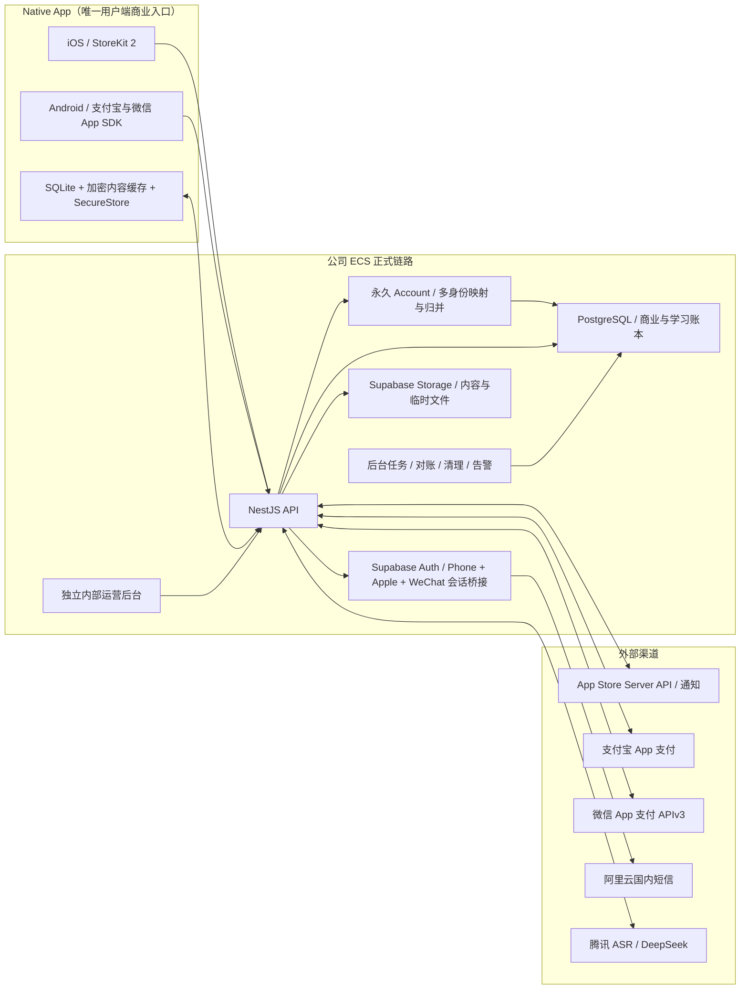

# Native App 正式商业上线技术方案

状态：商业终局技术基线已锁定；当前执行内部 TestFlight 子集，生产 API/网关切换与上传已授权但尚未执行
制定日期：2026-08-12
需求：[requirements.md](requirements.md)
技术盘点：[technical-audit.md](technical-audit.md)
执行路线：[roadmap.md](roadmap.md)
人工事项：[manual-actions.md](manual-actions.md)

## 1. 方案目标

在不重写现有产品、不迁移邀请码账号、不改变用户 Web/Vercel 的前提下，将当前 Native 内测架构升级
为可正式收费、可跨 iOS/Android 恢复、可控制 AI 成本、可执行隐私权利并可独立发布的商业系统。
本方案保留 D1—D9 描述的商业终局，但当前只实现第1.1节的内部 TestFlight 子集。

商业终局方案只覆盖：

- iOS、国内 Android Native App；
- 支撑 Native 的 ECS API、自托管 Supabase、PostgreSQL、Storage、后台任务和监控；
- 与用户 Web 隔离的内部运营后台；
- 与冻结 Vercel 隔离的 App 法律页和 Android 安装包分发设施。

明确不覆盖现有 Expo Web/Vercel、真人小班、微信咨询、自动续费、Google Play 和国内安卓应用商店
接入。社交登录仅进入 Native App 及其必要后端，不进入冻结 Web。

### 1.1 当前内部 TestFlight 实施剖面

当前里程碑采用最小且可继续扩展的技术剖面：

| 能力 | 当前实现 | 当前明确不做 | 后续接续点 |
| --- | --- | --- | --- |
| 平台 | iOS 内部 TestFlight 优先；共享代码保持 Android 可编译 | Android 对外分发 | Android 独立发布阶段 |
| 范围 | Native App、必要 App API 与 Auth 公网网关；当前仍为本地候选 | Expo Web/Vercel 的任何修改、构建或部署 | 生产 API/网关更新后上传内部 TestFlight；Web 持续冻结 |
| 登录 | 微信、Apple（iOS）、`+86` OTP/密码；第三方首次登录自动注册并先进入；手机号稍后绑定 | 不恢复邮箱/邀请码登录，不把提供方身份当业务主键 | 永久 `accountId`、账号归并、外部平台配置与真机验收 |
| 短信 | 阿里云已锁定；“云启航科成都”签名/通用模板已审核并实发；Supabase Send SMS Hook、Standard Webhooks 验签、Aliyun adapter 与基础限流已完成 | 不伪造“听你五个”的商标来源，不把单号码收件等同三网/公开放量验收 | 三网实测、设备/IP风控和多实例共享计数 |
| 支付 | 稳定 TypeScript 合同、禁用提供方、`commerce=false` | StoreKit/支付宝/微信 SDK、商品、下单、验单和真实资金 | 阶段6A/6B 实现同一合同 |
| AI 点数 | 版本化推荐测试策略，可由配置整体替换 | 对外承诺具体点数、正式成本预算 | 成本审计后发布正式策略版本 |
| 运行环境 | 本地/隔离环境验证；生产 API/网关更新和内部 TestFlight 上传已纳入当前目标 | 未经确认执行 Production 数据库迁移；外部测试或正式商店发布 | 备份/评审完成后，数据库迁移在临执行前单独确认 |

测试 OTP 必须同时满足显式非生产环境、显式功能开关和受控测试号码三项条件；任一条件不满足即
拒绝发送/校验。Production 配置不得存在可启用测试验证码的回退路径。支付禁用提供方必须稳定返回
“当前测试版本未开放购买”的可识别结果，不能打开网页、调用渠道或授予权益。

上述表格区分当前基础与新 D2 终局。现有 iOS/Android 已提供“验证码登录 / 密码登录”基础；本次在
其上新增多身份账号层、OTP 自动注册、Apple/微信和手机号绑定/归并。只有数据库迁移、外部提供方
配置、部署和真机验收全部完成后，才能把多入口登录称为已上线。

## 2. 商业终局总体架构

下图描述未来正式商业上线的目标。当前 TestFlight 已有阿里云真实短信基础，但不代表支付、运营后台
或其他商业生产能力已经接入；本轮新增账号/API/网关仍是本地候选。



冻结的 Expo Web/Vercel 不在图中，因为它不接入正式账号、支付、权益、内容授权或 Native 数据。

## 3. 技术决策

### TADR-01：保留现有技术栈和唯一来源

- Native 继续使用 React Native、Expo SDK 55、TypeScript、Expo Router、Development Build 和
  CNG/Prebuild。
- API 继续使用 NestJS；数据库继续使用 PostgreSQL + Drizzle；Supabase 继续负责正式身份和存储。
- 题库、资源、音频、录音和同步继续扩展当前唯一 owner，不复制第二套来源。
- 不引入 WebView，不为 iOS/Android 各写一套业务 App。

### TADR-02：商业化能力只进入 Native 平台实现

- 新增身份、会员、支付、点数和内容访问 UI 放在 `.native`、`.ios`、`.android` 模块中。
- 需要使用现有共享路由时，冻结的 `.web` 模块保留当前行为；不得让新 Native 依赖进入 Web bundle。
- `api/`、`vercel.json`、Web 物化/发布脚本、现有 Web 专属模块和现有 Vercel 项目禁止修改或发布。
- 建立 Web 冻结 manifest 和检查脚本；Native Release 门禁必须验证 Web 拥有文件未变化。
- 当前里程碑禁止触发 Expo Web export、Vercel preview/production 或任何 Web 构建；即使共享代码可
  编译，也必须通过平台隔离证明冻结的 `.web` 行为未被改写。

### TADR-03：认证身份与永久业务账号分离

- Supabase Auth 继续作为 App 会话验证源；Phone、Apple 和微信桥接产生的 `auth.users.id` 是认证身份
  ID。新增永久 `accounts.id` 作为业务 `accountId`，`account_identities` 将一个账号关联到多个已验证
  身份。学习、会员、订单、点数与同步只使用 `accountId`。
- 手机号规范化为中国大陆 `+86` E.164。OTP 登录允许自动注册；密码登录直接使用 Supabase
  `signInWithPassword({ phone, password })`。手机号是找回和归并锚点，但不直接做业务表主键。
- Apple 使用 Expo SDK 55 `expo-apple-authentication` 获取带 nonce 的原生 ID Token，再调用 Supabase
  `signInWithIdToken({ provider: 'apple' })`；Apple 身份经服务端映射到永久 `accountId`，后续绑定已占用
  手机号时通过双凭证归并进入手机号主账号。
- 微信由 Expo Development Build 中的原生 OpenSDK 获取一次性 code；NestJS 用服务器侧 AppSecret
  换取并校验 UnionID/OpenID，通过受控会话桥接落到 Supabase 会话。交换入口按来源限流，并用密钥
  HMAC 摘要对一次性 code 做窗口去重；同一 code 不能二次消费。微信身份映射只保存不可逆摘要；
  UnionID/OpenID、AppSecret 和 access token 不进入客户端或普通日志。
- 第三方首次认证成功后自动创建 `accountId` 并进入 App。普通 API Guard 只要求合法会话、可解析的
  活跃 `accountId`，不再要求会话必须带手机号。
- 第三方绑定未占用手机号时，将 phone identity 加到当前源账号并保持源 `accountId` 不变；只有目标
  手机号已属于其他账号时，才在当前第三方会话下验证目标手机号 OTP 并归并到手机号账号。两条路径
  都在数据库事务内生成最终 `AccountSummary`；归并路径仅在事务成功后把手机号主账号会话返回 App。
  归并要迁移学习/同步/点数/权益/订单等归属、移动身份映射、撤销源账号会话，并留下审计记录。
- 账号归并对同一提供方不同身份、不可合并订单/实名信息或并发变化失败关闭，不静默覆盖。昵称、头像、
  设备 ID 和支付昵称不得参与自动归并。
- 新用户通过 phone OTP 验证后可直接进入；密码为可选增强。拿到已认证手机号会话后调用受保护的
  `POST /v1/account/password`，由 API 给同一 auth user 设置密码，不得让客户端直接 `updateUser`，也
  不得为了设密再次 `signUp`。
- Native 不直接调用公网 GoTrue 发码：普通 OTP/自动注册调用自有
  `POST /v1/auth/phone/otp/start`，密码找回调用 `POST /v1/auth/phone/recovery/start`。服务端内部对找回
  强制 `shouldCreateUser=false`；未知与已知手机号都返回同形 `accepted` 响应并经过统一最短响应时间，
  绝不能在找回流程创建新用户。
- 公网 Auth 网关阻断 `/auth/v1/otp`、`/auth/v1/resend`、`/auth/v1/signup`，使普通客户端不能绕过
  自有 API 的中性错误、供应商 Hook 和风控。验证码校验与手机号密码登录仍使用允许的 GoTrue 会话
  接口；门禁由发布检查覆盖。
- 普通修改密码先在受保护的 `POST /v1/account/password` 中用当前密码刷新为近期会话，再由 API 将
  `current_password` 与新密码一并交给内部 GoTrue 原子校验和更新。首次设密或忘记旧密码时，必须先用
  OTP recovery/setup 建立受限、可到期且绑定当前用户/用途的授权；这类经短信验证的会话免旧密码，
  但不能仅凭路由参数跳过短信重认证。公网网关阻断 `PUT/PATCH /auth/v1/user`，客户端不能绕过账号 API
  直接改密。密码更新成功后，当前锁定的 GoTrue 版本按已启用的安全配置自动撤销其他会话。
- 第三方绑定手机号要求近期认证。Apple 只从当前会话 AMR 中读取 `method=oauth`（provider 存在时还要
  匹配 Apple）的时间戳，不能用更晚的 TOTP/其他 AMR 冒充 Apple 重认证。微信 code 交换成功后，服务端
  为对应 `authUserId + sessionId` 签发10分钟有效、只允许手机号绑定且消费一次即删除的 grant；页面
  参数或普通 OTP AMR 不能替代该 grant。
- 当前微信 code 去重、来源限流和 recent-auth grant 使用单 API 进程内短期状态；进程重启时 grant
  失效并要求重新微信认证，属于失败关闭。扩为多 API 实例前必须迁入带 TTL、原子消费语义的共享存储，
  防止跨实例绕过去重或把合法绑定随机路由到无 grant 的实例。
- 密码规则由 Supabase 服务端配置权威执行，客户端只镜像提示。当前 Native 覆盖层已按推荐初值配置为
  至少10个字符且同时包含字母与数字，并要求密码修改的当前密码/重认证安全配置；允许密码管理器
  生成的符号密码，不做周期性强制更换。正式启用前仍需在 Staging 验证旧版客户端错误兼容和泄露密码保护能力。
- 使用 Supabase Send SMS Hook 接入国内供应商；Hook 到短信发送适配器的请求必须验证签名、限流，并
  只记录 provider request ID、状态和脱敏号码，不记录 OTP 正文。
- 当前仓库已实现 Supabase Send SMS Hook → NestJS → 阿里云短信适配链路。Hook 使用
  Standard Webhooks 原始请求签名/时间戳校验；发送日志不得包含完整手机号或 OTP，只保留供应商请求
  ID。阿里云关闭或关键配置缺失时必须失败关闭。
- 资质主体固定为“云启航科（成都）科技有限公司”；签名“云启航科成都”和通用验证码模板已经审核
  并完成真实发送。用户当前没有“听你五个”注册商标，阿里云当前页面只接受企事业单位名或已注册
  商标来源，因此在商标注册完成或具备平台认可材料前不得以不实来源提交该品牌签名。由于 Send SMS
  Hook 不提供可靠的注册/登录/找回用途字段，本期三种流程共用通用身份验证码模板：
  `您的验证码为${code}，5分钟内有效，请勿泄露。如非本人操作请忽略。`。
- 受控测试 OTP 只允许非生产环境与白名单号码，Production 构建必须失败关闭，且测试覆盖层不得与
  阿里云真实短信覆盖层同时启用。现有企业开通、现用签名/模板和代表号码真实收件已完成；本轮新增
  自有 API/网关和多入口账号能力仍只在本地，尚未部署或上传。生产 API/网关更新与内部 TestFlight
  上传已获授权，数据库迁移仍要在备份/评审后临执行前单独确认。
- 当前应用层默认预算为全局200条/日、2000条/月、同一脱敏号码5条/小时和10条/日。该实现只在单一
  API 进程内生效并随进程重启清空；正式多实例前必须迁移到 Redis/数据库，并在 Hook 之前的验证码
  请求入口补齐设备/IP 维度控制。供应商控制台限频仍必须同时开启。
- 如果当前自托管 Auth 版本不支持 Send SMS Hook、phone password 或所需的密码重认证参数，先在
  隔离 Staging 升级并验证，不另建一套 NestJS 密码/OTP
  身份系统。
- 迁移采用兼容策略：现有账号初始 `accountId` 等于原 `auth.users.id`，避免一次性改写全部业务数据；
  新登录和归并后由映射层解析，业务代码不得依赖两者继续相等。
- 将 Guard 拆成“有效认证身份”与“活跃业务账号”两层，移除手机号硬门槛和正式 API 对
  `invite_accounts` 的依赖。
- 邀请码表和旧代码先冻结、后清理，不迁移旧账号或旧数据，不在同一阶段破坏性删除历史表。

#### 真实短信供应商选择

| 供应商 | 适配方式 | 当前官方成本参考 | 合规/风控事实 | 结论 |
| --- | --- | --- | --- | --- |
| 阿里云国内短信 | Supabase Send SMS Hook → 服务端 Aliyun adapter | 以阿里云控制台实时价格为准，低量按量模式起步 | 企业资质、签名、验证码模板和运营商实名报备；供应商限频与应用预算并行 | **已锁定首发**：“云启航科成都”已审核并真实收件；三网和共享风控待完成，“听你五个”因无注册商标而延期 |

阿里云现有“云启航科成都”签名与通用验证码模板已经完成一次真实收件；当前继续使用该合规签名。
“听你五个”只有在商标注册完成或取得平台认可材料后才单独申请，不是当前登录或 TestFlight 的
前置条件。继续用移动、联通、电信代表号码对到达率、延迟、失败回执和拦截做同条件实测。首版不做
双供应商自动切换，避免
错误重试导致用户收到两条验证码或成本翻倍；只有阿里云长期不可用时，才在同一 Hook 合同下另行
评估替代供应商。

供应商密钥只进入 ECS/Staging 的受保护 Secret/环境注入；仓库、文档、客户端、构建日志和聊天均
不得出现 AccessKey、Secret、SDK AppID 私密部分或完整 OTP。服务端使用最小权限凭证，发送预算、
异常增长告警和紧急关闭必须与供应商控制台限频同时存在。

### TADR-04：服务端账本是商品、订单、权益和点数的唯一权威

- 客户端展示商品，但不决定价格、时长、权益或点数。
- 渠道交易验证成功后，服务端写不可变支付事件，再生成权益与点数事件。
- 当前会员结束时间和点数余额是可重建投影；投影损坏时可以从不可变事件重算。
- 同一渠道交易号全局唯一；同一通知、客户端重试或对账重放只产生一次业务结果。
- App 任一端购买后，另一端读取同一 `userId` 的服务端投影，因此不存在客户端“跨平台迁移购买”。

### TADR-05：支付先稳定合同，官方能力留到商业阶段

当前内部 TestFlight 只提供纯 TypeScript `CommerceProvider` 合同和 `DisabledCommerceProvider`：

- 合同预留 `listProducts`、`purchase`、`restore` 和结果/错误类型，但 `commerce=false` 为默认且
  唯一允许的当前配置；
- 禁用提供方不访问网络、不创建订单、不授予权益，购买 UI 隐藏或明确显示测试阶段未开放；
- 当前不添加 StoreKit、支付宝或微信依赖，不新增原生支付权限、URL Scheme、渠道 AppID、商品 ID、
  服务端通知或商户密钥；
- 测试只验证禁用状态、调用失败关闭、无外部跳转及无权益副作用。

后续商业阶段在保持 TypeScript 合同稳定的前提下建立本地 `commercial-payments` Expo Module：

- iOS Swift 部分直接封装 StoreKit 2，返回商品、购买结果和签名交易 JWS；
- Android Kotlin 部分只封装支付宝与微信官方 App SDK 的调起和回调；
- TypeScript 只暴露稳定的 `listProducts`、`purchase`、`restore` 和渠道回调接口；
- 所有永久授权由服务端验签/查询后生成，Native SDK 返回“成功”只触发服务端查询；
- 不使用 WebView、H5 支付或客户端私钥，不把商户密钥编入 App；
- 原生 SDK、插件或权限变化按 Expo SDK 55 官方文档重新 Prebuild，并在双端 Development Build 验证。

本地模块比临时选择第三方 React Native 支付桥更可控，也使官方 SDK 升级、签名和安全审计边界清楚；
但它不是当前 TestFlight 里程碑的交付物。

### TADR-06：会员内容按发布物授权，Native 不内置整库

- 从现有题库唯一来源生成“公开目录/免费正文”“会员内容单元”“资源访问映射”三类发布物。
- Web 保持当前 repository；新增 `repository.native` 只加载免费发布物、授权会员单元和本机加密缓存，
  不静态导入完整 `question-bank.json`。
- 服务端对题库正文、答案、音频、图片、搜索、模考和深链接使用同一内容策略。
- 会员缓存使用 AES-GCM；本机生成的账号/安装级密钥保存在 SecureStore，缓存按 `userId` 命名空间
  隔离。退出、切号和注销时删除密钥与索引。
- 离线凭证使用服务端非对称签名，包含用户、安装设备、权益版本、内容范围和截止时间；本地 Native
  模块验证签名。有效期不超过72小时且不越过当前会员到期时间。
- 本方案防止普通解包和换号读取，不承诺阻止 Root/越狱后对运行时内存的极端提取。

### TADR-07：每次 AI 操作使用统一状态机

AI 请求按以下状态执行：

`created → points_reserved → cost_reserved → running → settled | failed | cancelled | expired`

- 唯一键为 `userId + operationId + capability`；数据库先占位，重复请求返回原任务状态。
- 开始前同时检查用户点数、会员/免费来源、单用户内部成本、并发、高频窗口和全局预算。
- 成功后按公布规则扣点、按真实音频秒数/Token 结算内部成本；系统失败释放点数和成本预占。
- 同一用户同一时间只运行一个外部 AI 任务；过期任务由后台任务回收。
- 用户点数、内部成本、模型价格和风控规则分别版本化。

### TADR-08：同步使用服务端数据代次阻断旧设备回灌

- `profiles` 增加 `dataGeneration`；每个 push、pull、mutation 和本地 outbox 都携带代次。
- “清除学习数据”在一个数据库事务中增加代次并删除/标记当前代数据；服务端拒绝旧代次 mutation。
- 客户端收到 `stale_generation` 后丢弃旧 outbox，清理本机账号数据并从新代次重新绑定。
- 单条删除使用 tombstone/删除 mutation 传播；AI 文字结果纳入明确的账号级数据类型。
- 会员、订单、点数和账号安全状态不进入学习同步，以专用服务端 API 为准。

### TADR-09：注销是编排任务，不是一条级联删除语句

注销按以下顺序执行：

1. 手机 OTP 重新验证并确认放弃权益；
2. 立即撤销全部会话、停止签发内容凭证和 AI 操作；
3. 写入注销事件，将订单/支付/安全证据转换为隔离主体标识；
4. 删除活跃账号资料、学习数据、AI 结果、会员投影、点数余额和可删除对象；
5. 删除 Supabase Auth 用户并使旧 `userId` 永久失效；
6. 对失败步骤重试并由审计任务确认最终完成；
7. 备份副本在7天循环中自然过期，恢复备份时重新应用注销事件。

同一手机号重新注册由 Supabase 创建新认证身份，并由业务层创建新 `accountId`；旧订单不能恢复，
免费点数按新账号规则重新发放。

### TADR-10：内部运营后台是独立受控应用

- 在 `apps/ops-console/` 建立独立 React + TypeScript 内部应用，不导入用户 App 的 Expo Web 页面，
  不部署到 Vercel。
- 这是 D8 授权的独立系统边界；首发角色只有管理员和客服。
- 工作人员使用独立账号和 MFA；用户账号不能登录后台，工作人员账号不能登录用户 App。
- 后台只调用 `/v1/admin/*` 管理 API，不直接连接数据库。
- 客服默认查看脱敏信息；退款、补偿、赠送、封禁、导出和注销协助按权限控制并完整审计。
- 部署目标为独立内部域名/入口，必须经过单独生产授权；不得改造现有 Vercel 项目承载后台。

### TADR-11：先具备可恢复性，再接受真实付费

- 数据库和 Storage 在现有同机备份之外增加中国境内、独立故障域的加密副本。
- 每日备份校验 checksum，至少定期执行隔离恢复；支付/权益事件和关键配置纳入备份。
- API 输出结构化日志和请求 ID；增加登录、短信、支付、权益、AI、同步、内容签发和注销指标。
- 告警覆盖可用性、通知积压、支付对账差异、负余额、AI 预算、备份失败和清理任务失败。
- 产品分析只记录第一方最小事件，不引入广告或第三方行为分析 SDK。

### TADR-12：所有高风险能力用开关和投影验证渐进启用

- 先在 Staging 建表、回放和端到端测试，再迁移 Production。
- 新能力默认关闭：`phoneAuth`、`commerce`、`protectedContent`、`aiPoints`、各支付渠道、后台写操作。
- 先启用读取/影子计算，对比新旧结果；再开启写入；最后删除旧路径。
- iOS 与 Android 的支付和发布开关独立，不因另一端未完成而阻塞已经就绪的一端。
- 当前 TestFlight 固定 `commerce=false`、所有真实支付渠道关闭、测试 OTP 仅非生产可启用；AI 测试
  策略使用独立策略 ID。若环境标识缺失或矛盾，构建/启动检查必须失败，不能猜测为测试环境。

## 4. 服务端数据模型

本节是商业终局模型。当前 TestFlight 只实现登录所必需的数据/合同以及支付和点数的稳定接口；不为
尚未启用的真实订单、渠道交易或运营后台执行 Production migration。

实际字段在迁移设计中定稿，但表职责必须保持分离：

| 领域 | 表/投影 | 核心职责 |
| --- | --- | --- |
| 账号 | `profiles`、`account_devices`、`policy_acceptances` | 账号状态、14+声明、协议版本、数据代次、设备会话 |
| 商品 | `commercial_products`、`channel_products` | 五档时长、基准价、渠道商品 ID、版本和启停 |
| 订单 | `orders`、`payment_transactions`、`payment_events` | 用户订单、渠道证据、通知/查询结果和幂等 |
| 权益 | `entitlement_events`、`entitlement_projection` | 时长增加/撤回事件与当前最终到期时间 |
| 点数 | `point_grant_batches`、`point_ledger`、`point_balance_projection` | 31天批次、扣点/退还/失效流水和余额 |
| AI | `ai_operations`、`model_price_versions`、`cost_ledger`、`cost_projections` | 幂等任务、模型成本、预占结算和预算 |
| 内容 | `content_releases`、`content_packages`、`content_access_events` | 免费清单、会员单元、资源映射和访问记录 |
| 隐私 | `deletion_jobs`、`retention_jobs`、`legal_record_subjects` | 注销编排、定时清理和法定隔离 |
| 运营 | `staff_accounts`、`staff_roles`、`admin_audit_events` | 工作人员身份、角色和高风险操作审计 |
| 分析 | `product_events_daily` 或最小原始事件表 | 第一方漏斗和短期原始事件 |

所有金额使用整数最小货币单位；AI 内部成本使用整数微单位；时间以 UTC 保存并以明确的持续天数计算。
7/15/31/62/93天均指对应天数乘以24小时，不使用自然月。

## 5. 会员、重复购买、退款和点数算法

### 5.1 购买

每个已验证订单生成一个持续时间事件：

`segmentStart = max(购买验证时间, 当前最终到期时间)`

`segmentEnd = segmentStart + 商品持续天数`

因此所有套餐串行顺延，不存在覆盖、并行或平台冲突。订单事件保存原始顺序，当前投影可以重建。

### 5.2 点数批次

- 7天和15天商品在该订单权益段真正开始时释放一次批次；
- 31/62/93天商品在权益段开始及其后每31天释放批次；
- 购买发生时只创建计划批次，不提前发放尚未开始权益段的点数；
- 读取余额、开始 AI 操作和定时任务都会调用同一个“释放到期批次”事务，避免定时任务延迟影响用户；
- 有效会员内，已发放未用会员点数的可用截止时间动态取当前最终会员到期时间；再次购买自动延长；
- 会员已经最终到期并完成点数失效后，之后重新购买不会复活旧点数。

### 5.3 退款/撤销

- 渠道退款产生反向事件，不修改或删除原始支付事件；
- 只移除该订单尚未消耗的会员持续时间，已消费历史保留；后续仍有效订单按原顺序重新压紧；
- 取消该订单未来未发放批次，撤回该订单来源中尚未使用的点数；已经使用的点数不形成用户负债，
  但进入退款滥用风险记录；
- 重算后若其他订单仍提供有效会员，账号继续使用其权益；只有最终投影失效才在线锁定会员内容；
- 无法联系的离线设备最迟在现有最长72小时凭证到期后使用新状态。

## 6. API 合同

### 6.1 账号与设备

- `POST /v1/onboarding/complete`：记录14+声明和协议版本；
- `GET /v1/account`：脱敏手机号、账号状态、设备和协议状态；
- `POST /v1/account/phone-change/*`：新旧号码验证与换绑；
- `POST /v1/account/learning-data/reset`：增加数据代次并清除学习数据；
- `POST /v1/account/export`：创建可审计导出任务；
- `DELETE /v1/account`：使用近期手机号重认证启动注销编排。

### 6.2 商业与支付

- `GET /v1/commerce/products?platform=`：返回当前平台可售商品和服务端展示信息；
- `POST /v1/commerce/orders`：创建绑定用户、平台、商品和幂等键的订单；
- `POST /v1/commerce/apple/verify`：提交签名交易并由服务端核验；
- `POST /v1/commerce/alipay/prepare`、`POST /v1/commerce/wechat/prepare`：返回官方 SDK 调起参数；
- 渠道通知端点：只接收外部渠道，先验签、落原始摘要、幂等处理，再写权益事件；
- `POST /v1/commerce/restore`：查询/恢复当前账号历史交易；
- `GET /v1/commerce/orders`、`GET /v1/entitlements/current`：订单和当前权益；
- `GET /v1/points/balance`、`GET /v1/points/ledger`：余额、发放批次和消费明细。

### 6.3 内容

- `GET /v1/content/catalog`：目录、免费清单、锁定状态和版本；
- `GET /v1/content/units/:id`：按服务端策略返回免费或会员正文；
- `POST /v1/content/downloads`：生成账号/设备绑定的下载清单；
- `POST /v1/content/offline-credential`：签发最长72小时离线凭证；
- `POST /v1/content/resources/resolve`：按内容上下文签名资源，不再接受任意路径直接授权。

### 6.4 AI 与后台

- 所有 AI 请求增加客户端生成的稳定 `operationId`；响应返回预计/实际扣点和剩余点数；
- `/v1/admin/*` 使用独立工作人员 Guard、MFA 会话、角色授权和审计中间件；
- 管理写接口要求原因码和幂等键，高风险操作可以配置管理员复核。

## 7. Native 客户端结构

目标模块如下，具体文件可以在实施时按现有 owner 合并：

```text
src/features/auth/                 微信/Apple/手机号多入口、自动注册、绑定/归并、设密/找回与重认证
src/features/commerce/             商品、订单、购买编排、恢复购买
src/features/entitlements/         当前会员投影与页面访问判断
src/features/points/               AI 点数余额、批次和明细
src/features/content-access/       目录策略、下载、离线凭证、加密缓存
src/features/account/              设备、导出、清除数据和注销
modules/commercial-payments/       StoreKit 2、支付宝、微信官方 Native SDK 适配
packages/contracts/                App/API/后台共享的纯合同
```

当前登录工作在既有手机号流程上新增 Apple/微信和永久账号映射；支付仍只保留纯合同/禁用适配器，
`modules/commercial-payments/` 及三个真实支付渠道适配器保持未创建、未链接状态。

客户端不得保存可自行延长的会员到期时间或可自行增加的点数；本地只缓存带版本和服务器签名/时间的
投影。所有敏感写操作在服务器完成。

## 8. Web 冻结执行合同

实施阶段建立 `web-freeze-manifest`，至少记录：

- 当前本地冻结基线、对应 Git commit（若可得）和确认时间；
- `vercel.json`、`api/`、Web 专属模块、Web 物化/部署脚本和静态发布物的 checksum；
- 禁止发布约束；未来发生 Git push 前再补充 Vercel production deployment ID 和 Git 自动部署状态
  证据，当前不要求为此进入 Vercel；
- 禁止命令和禁止路径列表。

每次阶段审查必须满足：

1. 禁止路径没有差异；
2. 没有调用 Vercel CLI/API、preview 或 production deployment；
3. 新 Native 功能具备平台隔离，不改变冻结 `.web` 行为；
4. 内部后台、法律页或 APK 分发不使用现有 Vercel 项目；
5. 如确实必须修改 Web，立即停止并要求新的明确解冻授权。

## 9. 安全与密钥

- Apple、支付宝、微信、短信、AI、数据库、签名和后台密钥只进入 Staging/Production 受保护环境；
- 客户端只包含允许公开的 Supabase publishable key、渠道 AppID 等公开标识；
- 支付回调验签、Apple JWS 验证、渠道证书轮换和时间偏差处理必须有自动测试；
- 日志不记录 OTP、完整手机号、access/refresh token、支付凭证正文、录音、完整回答或私钥；
- 工作人员操作、商品配置和成本阈值修改均写不可删除审计事件；
- 数据库迁移独立评审、备份、执行和迁移后核验，不能随普通 API 发布自动执行。

## 10. 验证策略

### 当前内部 TestFlight 必须验证

- Native 登录界面提供微信、Apple（iOS）和规范化中国大陆 `+86` 手机号验证码/密码入口；第三方和
  OTP 首次认证自动注册，第三方可先进入后绑定；邀请码入口、请求和 Guard 依赖均退出；
- 普通/自动注册 OTP 与找回发码分别走自有 API；公网 GoTrue `/otp`、`/resend`、`/signup` 和
  `PUT/PATCH /user` 被网关拒绝。找回未知/已知号码的状态、响应体形状和最短响应时间一致；密码更新
  只能经受保护账号 API；
- Apple recent auth 只接受 method-specific OAuth AMR；微信交换具备来源限流、一次性 code 去重和
  绑定当前会话的10分钟单用途 grant；未占用号码绑定保留源 `accountId`，已占用号码才执行归并；
- 阿里云 Hook 的原始签名校验、供应商请求映射、基础预算/号码限流和 Secret 失败关闭通过自动测试；
  测试 OTP 只有非生产环境、显式开关和受控号码三重条件同时满足时可用，Production 配置失败关闭；
- 支付合同可被后续渠道实现替换，但当前禁用提供方不加载 SDK、不发网络请求、不生成订单/权益；
- AI 点数推荐测试值只从版本化配置读取，可整体替换，用户公开文案没有把它描述为正式承诺；
- iOS 构建、自动化和内部 TestFlight 真机核心流程通过；所有 Web 冻结路径无差异且没有 Vercel 行为。
  当前上述新增能力仍是本地候选，不能把检查通过记录成已经生产部署或已经上传。

本地多入口界面和认证服务只是代码证据。当前阿里云企业资质、现用签名/模板和一个代表号码真实收件
已经完成；真实用户 TestFlight 或正式候选仍须完成新账号迁移与 Auth/API 配置、Apple 新发布描述文件
和 Supabase provider、微信开放平台配置、三网真实发送及 iOS/Android 真机交互，并证明各入口在实际
环境返回同一 `accountId`。设备/IP 风控及多实例持久预算也仍属于公开放量硬门槛。

### 自动化

- 合同、类型、Lint、单元测试和 API E2E；
- OTP 限流、统一错误、重试和账号重新注册；密码规则、错误次数限制、首次设密、修改与短信找回；
- 自有 OTP/找回 API、未知/已知号码同形响应、公网 Auth 写入口门禁、受保护密码更新与发布配置检查；
- Apple OAuth AMR 与其他 AMR 混合时的拒绝；微信 code 重放/超限、grant 过期/重复消费和跨会话拒绝；
- 同一提供方身份跨端/重装保持同一 `accountId`；手机号 OTP/密码一致；第三方绑定未占用手机号不
  产生第二账号且源 `accountId` 不变；绑定已占用手机号通过双凭证归并后学习、权益和会话撤销结果
  一致；两条事务均直接返回最终账号摘要；
- 同步代次、旧设备回灌、双设备冲突、删除传播；
- 商品/订单/通知幂等、重复购买、退款重算、跨端恢复；
- 31天批次、累计、最终到期、重新购买不复活旧点数；
- AI 点数/成本预占、并发、失败释放、高频和全局熔断；
- 内容免费清单、服务端越权拒绝、正式包无会员正文、离线72小时和切号；
- 注销、留存隔离、清理任务、后台角色和审计；
- Web 冻结清单与禁止路径检查；
- iOS/Android Release 产物的包名、版本、签名、权限和运行时地址。

### 沙盒/真实渠道

- StoreKit Testing → App Store Sandbox → TestFlight；
- 支付宝/微信沙盒或官方联调环境 → 小额真实支付/退款对账；
- 国内移动、联通、电信代表号码的真实发送、延迟、失败回执、倒计时和多维风控；
- iOS/Android 双机跨端购买恢复、离线和注销；
- 最终 Release 包的弱网、后台、录音、AI、支付、升级和重装。

任何“客户端显示支付成功”都不能替代服务端渠道查询和权益投影证据；任何编译成功都不能替代真机
交互和正式包解包检查。

## 11. 发布、降级与回滚

- Schema 采用向前兼容的 expand → backfill/影子验证 → switch → contract；生产回滚优先关闭开关和
  回退 API，不直接逆向删除新表。
- 支付渠道可以独立关闭购买，但保留订单查询、恢复和已购权益读取。
- AI 可以关闭单项能力或供应商，不影响非 AI 学习和已生成结果。
- 会员内容授权异常时停止新下载，保留免费内容；不能回退到把整库重新塞入正式包。
- 手机 OTP 异常时暂停新验证码并保留已有会话、微信/Apple 与密码登录；单一社交渠道异常时独立
  关闭该入口，不影响其他方式；密码侧异常时保留 OTP 找回。任何降级都不能恢复邀请码或邮箱登录。
- iOS 与 Android 各自保留上一个可用 Release 和独立开关，分别暂停/回滚。
- 任何回滚都不得发布 Vercel 或恢复旧 Native API 域名。

## 12. 官方技术依据

- Expo SDK 55 SecureStore：<https://docs.expo.dev/versions/v55.0.0/sdk/securestore/>
- Expo SDK 55 AppleAuthentication：<https://docs.expo.dev/versions/v55.0.0/sdk/apple-authentication/>
- Expo SDK 55 Crypto/AES：<https://docs.expo.dev/versions/v55.0.0/sdk/crypto/>
- Expo Router 平台模块：<https://docs.expo.dev/router/advanced/platform-specific-modules/>
- Supabase Phone Login：<https://supabase.com/docs/guides/auth/phone-login>
- Supabase Password-based Auth：<https://supabase.com/docs/guides/auth/passwords>
- Supabase Users / phone identity：<https://supabase.com/docs/guides/auth/users>
- Supabase Send SMS Hook：<https://supabase.com/docs/guides/auth/auth-hooks/send-sms-hook>
- Supabase Apple Login：<https://supabase.com/docs/guides/auth/social-login/auth-apple>
- Supabase Identity Linking：<https://supabase.com/docs/guides/auth/auth-identity-linking>
- 微信开放平台移动应用登录：<https://developers.weixin.qq.com/doc/oplatform/Mobile_App/WeChat_Login/Development_Guide.html>
- Apple StoreKit 2：<https://developer.apple.com/storekit/>
- Apple App Store Server API：<https://developer.apple.com/documentation/appstoreserverapi>
- Apple 多平台服务规则：<https://developer.apple.com/app-store/review/guidelines/#multiplatform-services>
- 微信 App 支付接入准备：<https://pay.wechatpay.cn/doc/v3/merchant/4015478291>
- 支付宝网页/移动应用：<https://open.alipay.com/module/webApp>
- 阿里云短信服务：<https://help.aliyun.com/zh/sms/>
- 阿里云短信价格与限频：<https://help.aliyun.com/zh/sms/product-overview/billing-of-messages-sent-to-chinese-mainland/>、
  <https://help.aliyun.com/zh/sms/user-guide/message-rules/>
