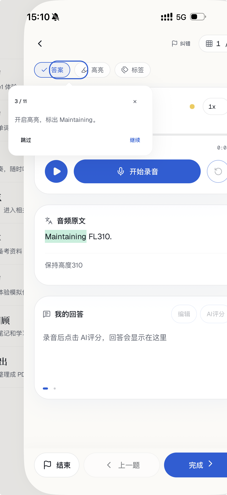
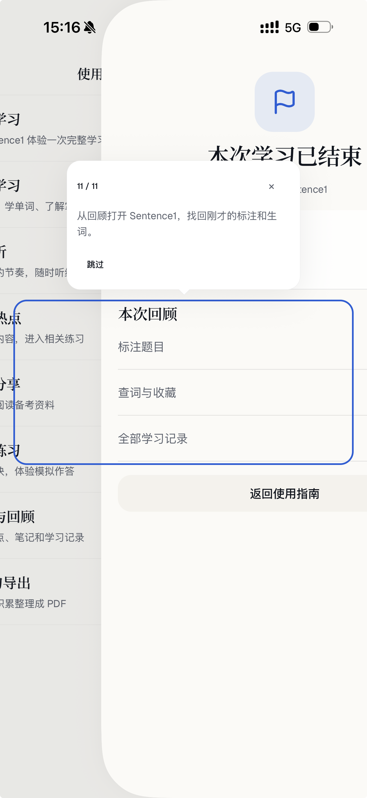

# 使用指南修复与首次使用引导：整体需求讨论稿

记录日期：2026-10-22
状态：已确认统一教学引擎与极简细线聚光灯，进入实现与验证。
本轮当前工作：按用户确认方案实现，进展见 execution.md。本文仅属于本次任务，不新增项目长期规则。

## 1. 整体目标

本轮包含两个相互关联的部分：

1. 系统优化现有完整使用指南，修复退出、页面跳转、提示定位及交互流畅性问题，并重新评估当前“蓝色框 + 悬浮提示卡”的交互形式。
2. 增加融入真实使用过程的首次使用引导：用户第一次用到某项功能时再教学，可以跳过；同一功能不反复自动教学。

完整使用指南用于用户主动查阅、体验功能；首次使用引导用于在实际操作中帮助用户上手。后者不应要求用户先主动进入使用指南。

## 2. 现有使用指南的问题与优化范围

### 2.1 用户反馈

- 进入教程后点击叉号，退出及后续页面状态存在问题，具体复现路径后续补充。
- 教程中的页面跳转、返回逻辑不符合预期，需要系统梳理。
- iOS 上拖动页面时，蓝色提示框看起来固定在原位置，与移动后的实际控件错位。
- OPI 热点的蓝框引导也存在卡顿、使用不顺畅的问题。
- 用户希望评估更换交互形式，不能把本轮范围仅理解为修正蓝框坐标。

### 2.2 截图证据

- 第 3/11 步提示“开启高亮，标出 Maintaining。”。
- 截图中蓝框落在“答案”和“高亮”之间，没有准确包围高亮按钮；页面处于横向偏移状态。

- 第 11/11 步提示从回顾打开 Sentence1，找回标注和生词。
- 当前页面向右偏移，左侧露出使用指南；蓝框横跨背景和当前页面，未与当前页面中的回顾区域保持一致。
- 悬浮提示卡覆盖部分页面内容，提示、目标和页面层级之间的关系不清楚。

以上是截图现象与用户反馈，不代表已完成设备复现或确定根因。用户口述的“固定蓝框”是体验描述；初步只读查看 `src/features/usage-guide/GuideOverlay.tsx` 可见现有实现会定时测量目标并绝对定位蓝框，不能直接认定根因是完全未更新坐标。具体手势、转场和层级问题留待诊断。

### 2.3 后续方案讨论范围

- 重新设计提示如何出现、如何指示操作目标，以及用户如何继续操作页面。
- 明确叉号、跳过、返回、继续、完成的区别及各自落点。
- 覆盖进入教程、进行中、结束学习、查看回顾、退出教程的完整路径。
- 关注滚动、iOS 页面拖动/返回手势、转场与弹层切换时的行为。
- 交互及视觉方向已选定，见下节；具体页面衔接和状态处理继续细化。

### 2.4 已选定：极简细线聚光灯（2026-10-22）

用户在四版视觉示意中明确选择“极简细线”。本次使用教学包含“我的 → 使用指南”主动进入与首次实际使用引导，两者采用同一视觉方向。

- 原页面布局保持不变，不向页面插入教学模块或常驻教学栏。
- 教学作为独立覆盖层呈现：半透明灰色遮罩压暗其他区域，当前操作目标镂空亮起，无蓝色描边。
- 使用简洁的无衬线文字，短标题与辅助说明形成轻量层级；细线与小圆点指向目标，避免粗大箭头和大面积提示卡。
- 提示不遮挡操作目标，用户直接点击或长按亮区内的原控件。
- 遮罩提供唯一的“跳过教学”入口；具体跳过后的进度记录与导航语义仍待细化，不由视觉选择推定。
- 高亮示意：照亮高亮按钮，开启后转到原文目标词，标记成功后结束该示例。
- 查词示意：照亮目标词，长按打开词典后转到收藏按钮。
- 回顾示意：照亮标注题目入口，点击后回到保留高亮的原题。

选定参考为本聊天的 `spotlight-visual-options.html` 中“极简细线”版本。示意用于确认视觉方向，不代表生产实现、全部流程或设备验收已完成；字体精确值、间距与遮罩参数在实现时对照现有 UI 令牌适配。

## 3. 首次使用引导

### 3.1 核心原则（用户已明确）

- 在用户第一次实际使用到功能时教学，不在启动时一次展示所有模块教程。
- 引导应带着用户体验操作，而不只是提供功能说明。
- 用户可以跳过。
- 同一功能只在首次使用时自动教学，不应每次打开重复出现。
- 共用的题库学习能力只教一次，不因换了题库或入口就重新教一遍。
- 不同模块可以在各自首次被使用时触发对应教学。

### 3.2 注册用户首次打开 App

期望流程：引导用户进入“我的”，设置备考目标、选择等级，并选择精选题库或最全题库。

具体页面承接、选择先后顺序、已有配置如何处理，以及首次打开的判定边界，后续讨论。此处不假定这些设置目前位于同一个页面。

### 3.3 首次真实题库学习

用户第一次从听力、九百句等入口进入涉及通用题库学习能力的实际学习时，在该次学习中引导操作。用户口述还举了“录工动画”的例子，暂记为疑似“陆空动画”，正式入口名称待核对。

教学覆盖用户提到的能力：

- 高亮。
- 标签。
- 笔记。
- 长按查词。
- 词典收藏。
- 录音、转写和 AI 评分。
- 结束学习后查看学习积累，并找回本次学习中的标注、生词等内容。

以现有使用指南中“题库学习”的完整体验为内容参考，但首次引导发生在用户自己的学习路径中。具体步骤、顺序以及某些题型不具备全部能力时如何处理，后续讨论。

示例：用户首次在九百句中完成通用题库学习教学，之后打开听力或其他使用同类能力的题库，不再重复整套教学。

### 3.4 其他模块首次使用

用户首次进入 OPI 热点时，再引导该模块特有的功能和操作。即使已完成通用题库学习教学，也可以首次学习热点特有能力；共用能力不应因此重复整套教学。

用户口述中的“API 热点”按现有 `guide-flows.ts` 中的“OPI 热点”记录。其他模块的纳入范围和教学内容尚未逐项确定。

## 4. 后续逐项讨论的问题

1. **聚光灯行为**：在已选定的极简细线形式下，细化页面手势、滚动定位、弹层及转场时的显示与隐藏。
2. **退出与导航**：叉号、跳过、返回、学习结束分别意味着什么，退出后留在哪里。
3. **首次判定**：新注册用户、已有用户、已有备考配置如何区分；记录按账号还是设备保存，多设备及重装如何处理。
4. **引导状态**：完成、跳过、关闭、中断分别如何记录；跳过之后是否再次自动出现、是否允许主动重看。
5. **能力与步骤**：通用题库教学如何拆分；首次进入的题型缺少某项能力时，后续如何补教尚未体验的功能。
6. **实际学习衔接**：录音、转写、AI 评分、学习积累如何在真实流程中完成教学，以及失败、中断时如何继续。
7. **模块清单**：除 OPI 热点外还包括哪些模块，各自首次触发点是什么。

上述问题是待讨论项，不是已确定的产品规则或技术方案。

## 5. 后续验收方向（待方案细化）

- 引导过程中关闭、跳过、返回、完成后的页面与状态符合最终约定。
- 页面拖动、滚动或切换时，提示不再错位、指向错误目标或残留到错误页面。
- 提示不妨碍用户完成当前要求的实际操作，交互流畅。
- 新用户能够按引导设置备考目标与题库范围。
- 真实学习首次教学可完成、可跳过；跨题库不会重复教授已完成的共用能力。
- OPI 热点等独立模块仅在首次使用相应功能时自动教学。
- 学习结束后能够按教学路径找到本次积累。

本次只完成需求记录及图片归档；尚无功能修复、设备验证或用户验收结论。

## 6. 实施确认（2026-10-22）

- 用户已授权开始实现，主动入口与首次自动入口共用同一核心逻辑。
- 取消固定 Sentence1、Maintaining 和固定示例学习包；主动入口引导选择真实题库，步骤匹配当前题目的能力。
- 跳过教学后该模块不再自动触发，仍可主动重学；跳过不等于完成。
- 老账号不强制自动教学，新注册账号启用；首次遇到未教过的能力时补教。
- 退出教学停留原页面，不调用结束学习、保存退出或返回指南流程。
- 本任务范围内，新确认逻辑优先于冲突旧实现；不变更其他任务与长期规则。
